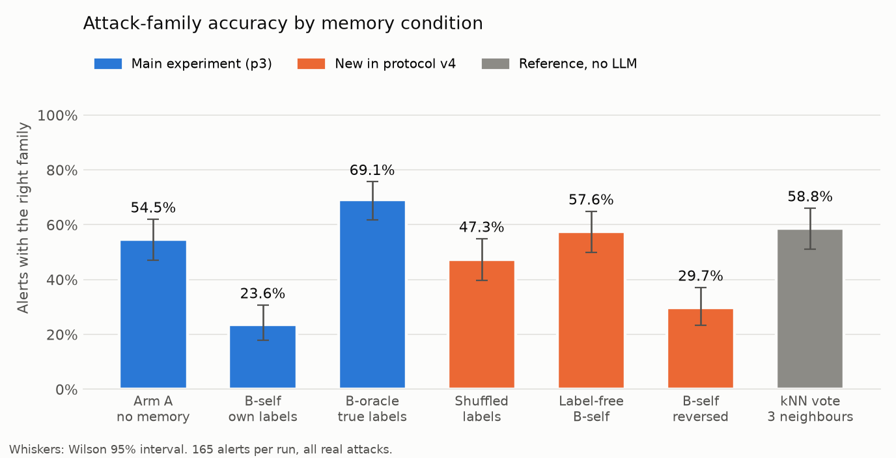

<div align="center">

# MemSOC

### Agentic SOC — Memory-Augmented LLM Alert Triage

*Does giving an LLM triage system a memory of past cases make it better, worse, or just different?*

[](./deploy/detection.Dockerfile)
[](./LICENSE)
[](./deploy/docker-compose.yml)
[](./requirements/detection.txt)
[](./dashboard/package.json)
[](./dashboard/package.json)

[-9ACD32)](./requirements/detection.txt)
[](./requirements/detection.txt)
[](./requirements/memory.txt)
[](./requirements/memory.txt)
[](./docs/log-generation/overview.md)
[](./PROJECT_BRIEF.md)

</div>

> Capstone project. Current phase: **Phase 5 — reporting layer.** Phases 0–4 are done.

A SOC alert triage system built around a persistent memory layer, evaluated against a memoryless baseline under strict experimental control.

---

## Contents

- [The problem](#the-problem)
- [The idea](#the-idea)
- [Research questions](#research-questions)
- [Results so far](#results-so-far)
- [Architecture](#architecture)
- [Experimental design](#experimental-design)
- [Objectives and deliverables](#objectives)
- [Evaluation](#evaluation)
- [Known risks](#known-risks)
- [Running it](#running-it)
- [Layout](#layout)
- [Documentation](#documentation)
- [Roadmap](#roadmap)
- [Stack](#stack)
- [License](#license)

---

## The Problem

SOC analysts drown in alerts, and many of the alerts that reach them do not need a human at all: routine scanning and probing that is real, but not worth waking anyone for. Worse, analysts repeatedly re-investigate alerts that have *already been resolved*, because the knowledge that resolved them lives in one analyst's head, or a Slack thread, rather than in the tooling.

When that analyst rotates off shift or leaves the team, the knowledge goes with them. The next person starts from zero.

## The Idea

Give the SOC a memory.

Every triaged case — the alert, its context, the verdict, and the reasoning — is embedded and stored in a vector database. When a new alert arrives, the system retrieves the most similar past cases and hands them to the LLM as precedent, so it reasons *with* institutional history instead of from scratch.

The intended result: fewer unnecessary escalations, more consistent verdicts, and knowledge that persists across shifts, analysts, and time — decoupled from any single person.

## Research Questions

**What does a memory layer actually contribute to LLM-based alert triage?** In four parts:

1. Does memory reduce **unnecessary escalations** without missing real threats? *(the headline)*
2. Does memory name the **attack type** correctly more often?
3. Does memory reduce **repeated mistakes** on alerts that look alike?
4. What does it cost to store the LLM's own **unchecked conclusions** instead of confirmed ones?

The memory layer is the crux of this research. Everything else in the system is held fixed so that its contribution can be isolated and measured.

---

## Results So Far

**In short: memory changes the model's decisions a lot, and what is stored in memory decides whether that helps or hurts.** Models largely copy the attack family of the cases they retrieve. Correct labels in memory help; the model's own unchecked verdicts can spread one mistake across every similar alert.

Main experiment (Gemma 4 26B, 165 real attack alerts, same alerts in every arm):

| Measure | Arm A (no memory) | B-self (own verdicts) | B-oracle (true labels) |
|---|---|---|---|
| Attacks caught (recall) | 74.5% | 86.7% | 98.8% |
| Attack family named correctly | 54.5% | 23.6% | 69.1% |

Protocol v4 then tested *why*, with five follow-up runs:

- **Correct labels are what make B-oracle work.** Shuffling its labels dropped family accuracy to 47.3%, below no memory.
- **Storing no family label removes the copying harm** (family accuracy 23.6% → 57.6%), but recall fell to 70.3%.
- **A memory full of attacks makes harmless traffic look dangerous.** On 100 hard benign flows, B-self escalated 98, against 63 with no memory.
- **B-self's recall gain did not survive a reversed alert order**, so that part of the main result is not robust.

<p align="center">
  
</p>

Full write-ups: [protocol v4 results](./docs/results-of-5-tests/README.md) · [main three-arm result](./docs/status/gemma-p3-results.md) · [all results to date](./docs/status/testing-results-to-date.md) · [executive summary](./docs/status/executive-summary.md)

---

## Architecture

```
[1] DATA STREAM  →  [2] DETECTION (ML)  →  [3] MEMORY (Vector DB)  →  [4] LLM TRIAGE + REPORTING
                                                    ↑______________________________|
                                                          (write-back loop)
```

| Layer | Component | Role |
|---|---|---|
| 1 | NF-UNSW-NB15-v3 flow replay | Deterministic alert stream simulating live SOC ingest, replayed from held-out data the detector never trained on |
| 2 | LightGBM classifier + SHAP | Flags attacks, predicts the attack type, and explains which features drove it. **Frozen**; not under evaluation |
| 3 | ChromaDB + sentence-transformers | **The research crux.** Stores past cases and retrieves the most similar ones as precedent |
| 4 | LLM | Decides each alert's verdict and attack type, and writes explainable reports |

End-to-end walkthrough: [`docs/architecture/end-to-end-pipeline.md`](./docs/architecture/end-to-end-pipeline.md).

## Experimental Design

Two arms, one variable.

- **Arm A — Memoryless baseline:** alert → LLM triage → verdict. No retrieval, no persistence.
- **Arm B — Memory-augmented:** alert → similarity retrieval → precedent injected into the same prompt → LLM triage → verdict → case written back to memory.

**Held constant across both arms:** the alert stream, the detection model, the LLM, and the prompt template. The presence or absence of the memory layer is the *only* difference. Arm B is Arm A plus a switch on the memory module, never a separate codepath.

Arm B runs under two memory conditions:

| Condition | Memory stores | Role |
|---|---|---|
| **B-self** | the LLM's own past verdicts, right or wrong | **The headline** — the system as it would actually be deployed |
| **B-oracle** | the true labels | A declared ceiling, never the headline |

Each memory run starts from an empty store, and each arm is run more than once so run-to-run variance can be reported.

---

## Objectives

1. **Reduce unnecessary escalations** — alerts that reach an analyst who did not need to see them — through similarity-based case retrieval, without missing the threats that do need a human.
2. **Enable memory retention and detailed, explainable reporting** — every decision stored with its context and rationale, retrievable and citable later.
3. **Give the SOC institutional memory beyond a single shift or analyst.**

## Deliverables

- **Memory retention** — vector DB storing past incidents as embeddings, retrieved by similarity.
- **Reporting & analysis** — explainable LLM-generated reports, not raw scores.
- **Dual-audience output** — a technical view for analysts and engineers, a plain-language view for management and compliance.

---

## Evaluation

Both arms replay the identical alert sequence and are compared on:

- **Escalation precision and must-escalate recall** (primary). Both halves are always reported together, because a system that escalates nothing would otherwise score perfectly. Attack families are split in advance into must-escalate and routine tiers.
- **Attack-type accuracy** (secondary), reported alongside the LLM's agreement rate with the detector so that simple echoing is visible.
- **Verdict consistency** across similar and near-duplicate alerts.
- **Latency and token-cost overhead** introduced by retrieval.
- **Quality of cited precedent** — does the LLM cite relevant past cases, or noisy matches?

Every proportion carries a confidence interval, and the arms are compared with a paired test on the same alerts. Alerts while memory is still filling are reported separately from those after it is full.

**A null or negative result is a legitimate outcome.** The evaluation is not designed to guarantee that memory wins.

## Known Risks

- **Error propagation (memory poisoning)** — a mis-triaged case in memory can repeat its error across every future similar alert. The most important failure mode; explicitly tested, not just noted.
- **Cold start** — memory begins empty, so early alerts get no benefit.
- **Retrieval noise** — similar-looking flows are not always the same kind of attack, and retrieval may surface misleading precedent. No similarity threshold is assumed to filter this out.
- **Dataset realism** — NF-UNSW-NB15-v3 is a synthetic testbed capture, not production traffic.
- **Frozen detector** — says nothing about behaviour with a noisy, real-world detection layer.

---

## Running It

> **Setting up, or pulling after the restructure?** Read
> **[`docs/deployment/operations.md` §2 — Before You Test](./docs/deployment/operations.md)**
> first. It covers first-time setup, migrating off the old `Deployment/`
> layout (order matters — stop the old stack *before* pulling), which
> images to rebuild, and a four-step pre-test checklist.

**Prerequisites:** Docker with Compose, and a local copy of `NF-UNSW-NB15-v3.csv` (not in the repo). Point `MEMSOC_HOST_DATA` at the folder that holds it — see step 3 of the operations guide.

Three services start by default:

| Service | Default URL | What it is |
|---|---|---|
| Dashboard | <http://localhost:8080> | React UI; <http://localhost:8080/api-docs> documents **every endpoint in both services** with working "Try it out" buttons |
| Detection | <http://localhost:8000/docs> | Frozen LightGBM + SHAP |
| Report | <http://localhost:8001/docs> | LLM triage and report generation |

```bash
docker compose -f deploy/docker-compose.yml build
docker compose -f deploy/docker-compose.yml up -d
```

Drive the full workflow interactively — generate flows, classify them,
produce a report:

```bash
docker compose -f deploy/docker-compose.yml --profile workflow run --rm controller
```

Useful one-shots:

```bash
# what resolved where, and what is missing
docker compose -f deploy/docker-compose.yml --profile tools run --rm paths

# contract tests
docker compose -f deploy/docker-compose.yml --profile tools run --rm tests
```

Every published port is defined once in `deploy/docker-compose.yml` and
can be overridden from `.env` (`MEMSOC_DETECTION_PORT`,
`MEMSOC_REPORT_PORT`, `MEMSOC_DASHBOARD_PORT`).

Full instructions, including the native (non-Docker) path:
**[`docs/deployment/operations.md`](./docs/deployment/operations.md)**.

---

## Layout

One source tree. `deploy/` holds build and orchestration files only.

```text
src/memsoc/        the application
├── paths.py       single source of truth for every path
├── api/           EVERY HTTP endpoint in the system
├── logstream/     Layer 1 — deterministic NetFlow replay
├── detection/     Layer 2 — frozen LightGBM + SHAP
├── memory/        Layer 3 — the memory layer (the research variable)
├── triage/        Layer 4 — LLM triage and reporting
└── controller.py  interactive end-to-end workflow driver

models/            the two LightGBM pickles
dashboard/         React app
deploy/            Dockerfiles + compose
requirements/      one file per deployable
artifacts/         all runtime output (gitignored)
notebooks/         analysis notebooks (run on the memsoc-memory kernel)
tests/  docs/  data/
```

---

## Documentation

- [`PROJECT_BRIEF.md`](./PROJECT_BRIEF.md) — authoritative design context. **Read this first.**
- [`CLAUDE.md`](./CLAUDE.md) — operating rules for anyone, human or AI, working in this repo.
- [`docs/README.md`](./docs/README.md) — documentation index.
- [`docs/decisions.md`](./docs/decisions.md) — open questions, settled decisions, and what was run.
- [`docs/PRODUCT_BACKLOG.md`](./docs/PRODUCT_BACKLOG.md) — **every known bug, gap and piece of tech debt.** Check here before assuming something is finished.
- [`docs/memory-layer/`](./docs/memory-layer/) — the memory layer (Layer 3): architecture, case schema, read/write paths, configuration, risks, open questions.
- [`docs/results-of-5-tests/`](./docs/results-of-5-tests/README.md) — the latest results (protocol v4), with figures.

## Roadmap

- [x] **Phase 0** — Setup, data prep, case schema definition
- [x] **Phase 1** — Memoryless baseline (Arm A)
- [x] **Phase 2** — Memory-augmented arm (Arm B)
- [x] **Phase 3** — Tuning: top-k, threshold, write policy, cold start
- [x] **Phase 4** — Evaluation and error-propagation analysis
- [ ] **Phase 5** — Reporting layer

## Stack

| Area | Tools |
|---|---|
| Detection | LightGBM 4.7 · SHAP 0.48 · scikit-learn 1.7 (frozen models in `models/`) |
| Memory | ChromaDB 1.5.9 (Apache 2.0, persistent mode) · sentence-transformers `all-MiniLM-L6-v2` |
| Triage | LLM over HTTP (Gemini API and Groq used in the experiments) |
| Services | Python 3.13 · FastAPI · Uvicorn · Docker Compose · nginx |
| Dashboard | React 19 · Vite · Recharts |
| Data | NF-UNSW-NB15-v3 |

## License

The code is released under the [MIT License](./LICENSE), copyright (c) 2026 The MemSOC Authors.

The license covers the code only. The NF-UNSW-NB15-v3 dataset, and the model files in `models/` that were trained on it, remain subject to the dataset's own terms.
