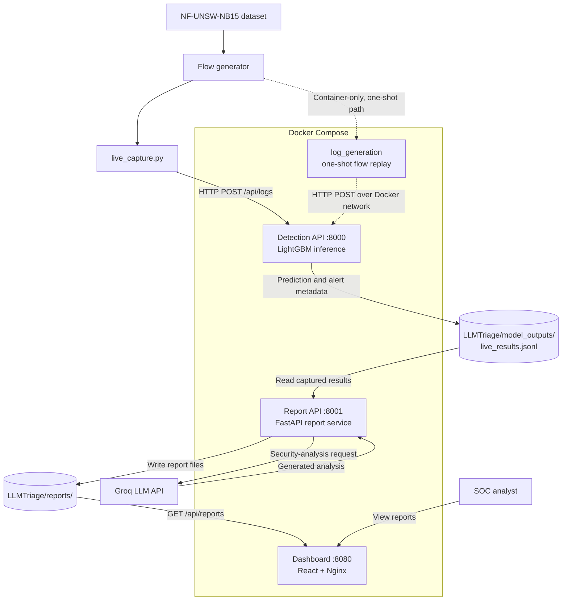

# MemSOC End-to-End Pipeline

The standard operational path is Dataset → live_capture.py → Detection → live_results.jsonl → Report → Groq → reports/ → Dashboard. The log_generation service is a one-shot Docker Compose flow-replay service that sends generated flows directly to the Detection API and does not itself populate live_results.jsonl.
