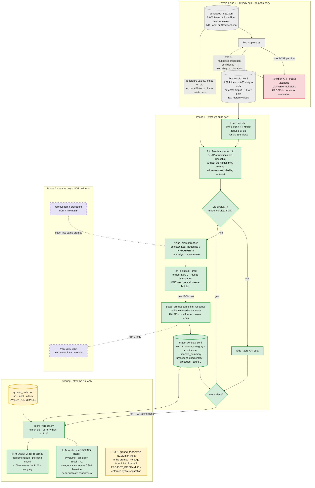

# Missing Per-Alert Verdicts & Absent False-Positive Headroom

> Two problems block Phase 1. Neither is a bug in the code — both are gaps between what
> [`PROJECT_BRIEF.md`](../PROJECT_BRIEF.md) specifies and what the repository and dataset can currently support.
>
> **Prepared:** 2026-08-30 · **Status:** ready to build, one decision outstanding

---

## The problem in one paragraph

The project's claim is that a **memory of past cases** improves LLM alert triage. Proving it means replaying
the same alerts twice — once without memory (Arm A), once with it (Arm B) — and measuring the difference.
Right now that experiment cannot run, for two independent reasons. **First**, Arm A produces no per-alert
verdicts, so there is nothing for Arm B to store as memory. **Second**, the dataset contains exactly one
false positive, so the primary metric has nothing to improve. Problem 1 is a build task. Problem 2 is a
decision the team has to take before any API requests are spent.

---

## What is scored against what

Three comparisons exist in this project. Only one of them is the experiment, and keeping them apart matters.

| # | Comparison | Role |
|---|---|---|
| 1 | Detector output vs ground truth | **Diagnostic only.** Problem 2 below. The detector is a frozen input, not under evaluation — this was run once to check whether the metric is capable of moving. |
| 2 | **LLM verdict vs ground truth** | **The experiment.** `score_verdicts.py` does this. Score Arm A, score Arm B, compare the two. |
| 3 | LLM verdict vs detector output | Secondary result: where the LLM overrules the frozen detector, and whether memory makes it overrule more or less often. Already flagged in [`memory-layer/02-case-schema.md`](./memory-layer/02-case-schema.md) under OQ-3. |

The chain is: **detector raises alert → LLM judges the alert → ground truth grades the LLM's judgment.**

A point that is easy to conflate: the LLM's *task* is to assess the model output — a verdict of
`true_positive` / `false_positive` means "was the detector right about this alert?" That assessment is then
*scored* against ground truth. Both statements are true, at different stages. The model output is an **input**
to the LLM, never the thing the LLM is graded against.

**Ground truth never enters the prompt.** It is opened only by `score_verdicts.py`, after the run, joined on
`uid`. This is the [`PROJECT_BRIEF.md`](../PROJECT_BRIEF.md) §5 "oracle only" requirement, and it is enforced
structurally rather than by discipline: `log_generation/generated_logs.jsonl` carries no label at all, and
`ground_truth.csv` is a separate file.

---

## Problem 1 — Arm A produces no per-alert verdict

### What the memory layer requires

[`PROJECT_BRIEF.md`](../PROJECT_BRIEF.md) §4 (Layer 3) defines the write path as embedding *"the case (alert
features + context + verdict + rationale)"*. A **case** is one alert plus the verdict and rationale the LLM
gave it. That is the unit stored in ChromaDB and the unit retrieved by similarity at triage time.

### What the code actually produces

`LLMTriage/generate_report.py` reads the whole captured stream and asks the LLM for a single **aggregate
narrative** over all of it — executive summary, risk analysis, threat analysis, recommendations, action plan
(`report_prompt.py:53-63`). Every number is computed in `stats_engine.py` and the LLM only writes prose
around them, which is a sound design for a *report*, but it emits **no per-alert verdict field anywhere**.

`LLMTriage/reports/sample-fuzzers_report.md` is closer to per-alert shape, but its verdict is prose in an
assessment line, not a structured, parseable, scoreable field.

An aggregate report also cannot serve as a memory unit: there is no meaningful similarity between *one
incoming alert* and *a narrative summary of 5,716 flows*.

### Consequence

Phase 1 as defined in [`PROJECT_BRIEF.md`](../PROJECT_BRIEF.md) §7 — *"fixed-prompt LLM triage… log verdicts
against ground truth"* — is not yet built. Phase 2 cannot start without it.

---

## Problem 2 — the primary metric has no headroom ⚠️

### Measurement

Joining the detector's captured output to `log_generation/ground_truth.csv` on `uid`, over the 4,653 unique
flows captured so far:

```
TP = 193    FP = 1    FN = 0    TN = 4459
detector precision = 0.995    recall = 1.000
```

The detector raised **194 alerts**, of which **193 were genuine attacks**. There is **exactly one false
positive in the entire stream**.

Reproduce:

```bash
python -c "
import json, csv
gt = {r['uid']: r for r in csv.DictReader(open('log_generation/ground_truth.csv'))}
seen = {}
for line in open('LLMTriage/model_outputs/live_results.jsonl', encoding='utf-8'):
    line = line.strip()
    if not line: continue
    try: r = json.loads(line)
    except: continue
    seen[r['uid']] = r
tp = fp = tn = fn = 0
for u, r in seen.items():
    if u not in gt: continue
    p = r['status'] == 'attack'; t = gt[u]['attack'] != 'Benign'
    tp += p and t; fp += p and not t; fn += (not p) and t; tn += (not p) and not t
print(f'TP={tp} FP={fp} FN={fn} TN={tn}')
"
```

### Why this matters

False-positive volume is the **primary metric** in [`PROJECT_BRIEF.md`](../PROJECT_BRIEF.md) §7 Phase 4. Of
the 194 alerts that reach triage, 193 are real attacks — so an LLM that blindly escalates everything already
scores 193/194. Arm A will be near-perfect and memory has essentially nothing to reduce.

Running the comparison as written would yield a flat result caused by **the dataset being too easy**, not by
memory failing to work. The experiment would not answer its own research question.

### This is not a bug

The detector drops `IPV4_SRC_ADDR` and `IPV4_DST_ADDR` before training
(`final_ml_model_v1/src/features/feature_engineering.py:18-28`), so there is no address leakage — a real
concern, since `stats_engine.py:182-187` notes source IP predicts the label with 100% accuracy on this
dataset. NF-UNSW-NB15-v3 is simply an easy synthetic testbed capture. This is the **dataset realism** risk in
[`PROJECT_BRIEF.md`](../PROJECT_BRIEF.md) §8 landing harder than the brief anticipated.

### On the timing of this measurement

[`CLAUDE.md`](../CLAUDE.md) forbids *"adjusting metrics after seeing results."* This measurement is a
**pre-run power check on the frozen detector**, not an Arm A vs Arm B result — no arm has been run. Checking
whether a metric is capable of moving before spending API requests is standard practice and is not what that
rule guards against.

That window closes the moment either arm runs. **The decision below should therefore be taken now.**

---

## The counterpart — category accuracy *does* have headroom ✅

The same 194 alerts, comparing the detector's `multiclass.prediction` to the ground-truth `attack` column:

```
detector category accuracy = 171/194 = 0.881
```

**23 mistakes.** The dominant confusions:

```
Exploits       -> Fuzzers          7
Reconnaissance -> Fuzzers          3
Exploits       -> Reconnaissance   3
Analysis       -> Exploits         2
Exploits       -> DoS              2
```

Reproduce:

```bash
python -c "
import json, csv, collections
gt = {r['uid']: r for r in csv.DictReader(open('log_generation/ground_truth.csv'))}
seen = {}
for line in open('LLMTriage/model_outputs/live_results.jsonl', encoding='utf-8'):
    line = line.strip()
    if not line: continue
    try: r = json.loads(line)
    except: continue
    seen[r['uid']] = r
alerts = [(u, r) for u, r in seen.items() if r['status'] == 'attack' and u in gt]
correct = 0; wrong = collections.Counter()
for u, r in alerts:
    pred = (r.get('multiclass') or {}).get('prediction'); true = gt[u]['attack']
    if pred == true: correct += 1
    else: wrong[(true, pred)] += 1
print('category accuracy: %d/%d = %.3f' % (correct, len(alerts), correct/len(alerts)))
for (t, p), n in wrong.most_common(): print('  %-16s -> %-16s %d' % (t, p, n))
"
```

**This is what makes Option A viable.** Where false-positive volume has 1 unit of headroom, category
correctness has 23 — and it fits the memory thesis directly. If Arm B retrieves past cases where similar
flows were confirmed `Exploits`, it should correct the detector's `Fuzzers` misfire more often than Arm A
does. That is a clean, measurable memory effect on a metric already named in
[`PROJECT_BRIEF.md`](../PROJECT_BRIEF.md) §7 Phase 4.

### Design consequence — guard against echoing

The prompt shows the LLM the detector's predicted category. If nothing counteracts that, the LLM will simply
repeat `Fuzzers` and score 88.1% by copying — and both arms will tie at the detector's own accuracy, making
the metric measure nothing. Two requirements follow:

- `triage_prompt.py` must state explicitly that the detector's label is a **hypothesis the analyst may
  overrule**, not a given.
- `score_verdicts.py` must report **agreement rate with the detector** alongside accuracy, so echoing is
  visible rather than hidden inside a good-looking score. An Arm A agreement rate near 100% means the LLM is
  copying.

---

## Decision required before any run

| Option | Effect |
|---|---|
| **A. Re-anchor to category accuracy + consistency** *(recommended — evidenced above)* | Primary metric becomes: does the LLM name the attack category correctly across the 8 classes, and does it give consistent verdicts on near-duplicate alerts? Both are already listed in §7 Phase 4. Headroom is **measured, not assumed**: the detector is 88.1% accurate on category against 99.5% on attack/benign, leaving 23 correctable mistakes. No protected component changes. Costs nothing. |
| B. Widen what enters triage | Feed a seeded sample of detector-benign flows into triage so the LLM can wrongly escalate, making FP volume measurable. Costs many more requests and changes what "an alert" means in the system. |
| C. Measure NF-CICIDS2018-v3 first | Check detector precision on the §4 target dataset before committing. If it is harder, the original metric works untouched. Note that a retrain invalidates every stored case per §8. |
| D. Proceed as specified | Run it, accept the flat result, document the ceiling as a limitation. Honest, but spends ~400 requests confirming what is already known. |

**This decision does not block the build.** The triage path is identical under all four options, and
`score_verdicts.py` will compute *every* Phase 4 metric. Which one is labelled "primary" is a documentation
decision recorded in [`memory-layer/07-open-questions.md`](./memory-layer/07-open-questions.md), not a code
change — but it must be settled before results exist.

---

## Supporting findings

### The API budget is not the constraint

Only **4.32%** of flows are flagged as attacks, and triage runs only on flagged alerts:

| | Requests |
|---|---|
| One pass, one arm | ~194 |
| Both arms, complete comparison | **~400** |

Affordable on a free tier. Response caching (below) means a crashed or repeated run costs nothing for alerts
already triaged.

**Do not batch multiple alerts into one LLM call to save requests.** Batching breaks Arm B's write-back
ordering — alerts 2..N in a batch cannot see alert 1's stored case — which biases the experiment *against*
the memory arm. The saving is not worth the contamination.

### The verdict schema already exists — do not invent one

[`memory-layer/02-case-schema.md`](./memory-layer/02-case-schema.md) §"Triage output (Layer 4)" already
specifies the fields. Phase 1 emits these and nothing else:

| Field | Type | Values |
|---|---|---|
| `verdict` | str | `true_positive` \| `false_positive` \| `inconclusive` |
| `attack_category` | str | detector's 8-category vocabulary + `none` / `unknown` |
| `confidence` | float | 0.0–1.0 |
| `rationale_summary` | str | ≤ 500 chars |
| `precedent_used` | str | `""` in Arm A — always |
| `precedent_count` | int | `0` in Arm A — always |

Observed category vocabulary from the detector's own outputs: `Fuzzers`, `Exploits`, `Reconnaissance`, `DoS`,
`Generic`, `Backdoor`, `Analysis`, `Shellcode`.

### OQ-9 is now answerable

[`memory-layer/07-open-questions.md`](./memory-layer/07-open-questions.md) OQ-9 states "the detector has not
been chosen." That is stale. It has been: LightGBM multiclass in `final_ml_model_v1/`, exposing per-alert
confidence (`multiclass.confidence`), a closed 8-label vocabulary, and a stable `uid` per alert. Closing OQ-9
with these observed facts unblocks the Phase 0 schema lock.

### Terminology hazard in the existing prompt

`LLMTriage/report_prompt.py:42` tells the LLM the detector's statistics *"are ground truth."* It means
"verified numbers," but "ground truth" has a specific, loaded meaning in this project
([`PROJECT_BRIEF.md`](../PROJECT_BRIEF.md) §5) and this wording will propagate confusion into generated
reports. Reword to "verified" / "pre-computed" — as a separate, approved change, not as a side effect of
Phase 1.

---

## Build plan

### End-to-end flow

Green is what Phase 1 builds. Grey is already built and must not be modified. Red is a protected component.
Amber is the evaluation oracle — note it touches **nothing** upstream of scoring. Purple dashed is Phase 2,
shown only so the seams are visible; none of it is built now.



Four things the diagram is asserting, each of which is a rule the implementation has to hold:

1. **Phase 1 reads two files and calls nothing.** `live_results.jsonl` for the detector's output, and
   `generated_logs.jsonl` for the feature values that output refers to. It never calls the detection API —
   running the model stays `live_capture.py`'s job. The second input was added during the build; see
   *Implementation notes* below for why it is required.
2. **The resume check comes before the API call**, not after. That is what makes a crashed run free to
   restart.
3. **`ground_truth.csv` connects only to `score_verdicts.py`.** The absence of any edge from it into the
   Phase 1 subgraph is the §5 constraint, drawn deliberately. If a future change ever gives
   `triage_prompt.py` access to that file, the experiment is invalid.
4. **The two Phase 2 seams attach to existing nodes**, they do not fork the pipeline. Arm B is Arm A plus
   those two dashed boxes — which is [`CLAUDE.md`](../CLAUDE.md) §Experimental Integrity's core requirement,
   and the reason the loop must not be written as two parallel codepaths.

**Grey box — what already existed**

You have 5,000 network connections in a file. live_capture.py sends each one to your trained ML model, which answers "attack" or "normal." Those answers get saved to a second file.

Two things to notice, because they cause trouble later:

- The first file has all the raw measurements (bytes, packets, timings) but no answers.
- The second file has the model's answer but not the measurements — only which measurements mattered, not what they were.

The red box inside is the ML model. Red = frozen. Nobody touches it.

**Green box — what we built**

For each of the 194 connections the model called an attack:

1. Load them and remove duplicates.
2. Join — pull the actual measurements from the first file. This is the arrow that goes from the grey box down into the green one. It exists because of the split above: without it the LLM is told "TTL mattered" without being told TTL was 31, and it can't decide anything.
3. Already done? If we've triaged this one before, skip it — costs nothing. This is why stopping and restarting is free.
4. Build the prompt, send it to the LLM, check the answer is a valid verdict (reject it if not — never patch it up).
5. Save the verdict, move to the next one.

**Amber box — the marking**

After every alert is done, score_verdicts.py opens the answer key (ground_truth.csv) and grades the LLM's verdicts.

The amber "STOP" box is the important bit. Notice there is no arrow from the answer key into the green box. That's deliberate: the LLM must never see the right answers while deciding. It only ever sees the connection's measurements and what the ML model guessed.

Two kinds of marking come out:
- vs ground truth — was the LLM right? (the actual experiment)
- vs the detector — did the LLM just copy the ML model's guess? If it agrees 100% of the time it isn't thinking, it's parroting, and the score is meaningless.

Purple dashed box — next phase

Two steps that don't exist yet. When you build memory (Arm B), you insert one step before the prompt ("find similar past cases") and one after the answer ("save this case for next time").

They're drawn as dashed arrows attaching to boxes that already exist — that's the whole point. Arm B isn't a separate program; it's this same pipeline with two extrasteps. If it were built as a second copy, any difference in results might come from the copy rather than from memory, and the experiment would prove nothing.

### Files to create

| File | Purpose |
|---|---|
| `LLMTriage/triage_prompt.py` | Per-alert prompt construction and strict JSON parsing. Mirrors `report_prompt.py`'s structure: a `render()` plus a `parse_llm_response()` that validates required keys and raises on malformed output rather than repairing it. |
| `LLMTriage/triage_runner.py` | The per-alert loop: load alerts, one LLM call each, validate, append verdict. Handles caching and resume. |
| `LLMTriage/score_verdicts.py` | Joins verdicts to `ground_truth.csv` on `uid` and computes every Phase 4 metric. No LLM involved — pure Python, same discipline as `stats_engine.py`. |

Three new files rather than additions to existing ones: `report_prompt.py` serves the aggregate report and is
a different concern, and [`CLAUDE.md`](../CLAUDE.md) forbids reworking adjacent code. The aggregate report
path stays untouched.

### Files reused, not modified

- `LLMTriage/llm_client.py` — `call_groq(prompt) -> (text, latency_ms)`. Already correct, already at
  `temperature=0`.
- `LLMTriage/stats_engine.py` — `read_live_results()` for loading, `PROTOCOL_NAMES` for protocol rendering.
- `LLMTriage/config.py` — add only two path constants (`VERDICTS_PATH`, `GROUND_TRUTH_PATH`). Nothing else.

### Input

`LLMTriage/model_outputs/live_results.jsonl`, filtered to `status == "attack"` and **deduplicated by `uid`**.
Deduplication is mandatory: the capture has looped past one full pass (6,525 lines for 4,653 unique flows), so
without it alerts get triaged — and billed — twice.

Each alert already carries everything the prompt needs: `multiclass.prediction`, `multiclass.confidence`,
`alert.dst_port`, `alert.protocol`, `alert.shap_explanation`.

### Output

`LLMTriage/model_outputs/triage_verdicts.jsonl`, one line per alert:

```json
{
  "uid": "C1424244486534-39220-1",
  "arm": "baseline",
  "seq": 412,
  "detector_label": "Fuzzers",
  "detector_score": 0.7228,
  "verdict": "true_positive",
  "attack_category": "Fuzzers",
  "confidence": 0.85,
  "rationale_summary": "...",
  "precedent_used": "",
  "precedent_count": 0,
  "model_id": "openai/gpt-oss-20b",
  "latency_ms": 2182,
  "triaged_at": "2026-08-30T09:14:03Z"
}
```

### Design constraints

From [`CLAUDE.md`](../CLAUDE.md) §Experimental Integrity:

1. **Single codepath.** No `if arm == "baseline"` branches. Phase 2 adds memory as a module plugging into two
   seams — a retrieval step *before* prompt render, a write step *after* parse. Shape the per-alert function
   so those seams exist naturally, but **do not build the toggle or any unused parameter now**. That is
   Phase 2's task.
2. **Arm A never writes to memory.** `precedent_used` is `""` and `precedent_count` is `0`, always. Verify
   before any baseline run.
3. **Reproducible.** Temperature 0, fixed stream order, model ID and timestamp logged per verdict.
4. **Resumable.** On start, read the existing verdicts file and skip any `uid` already present. A crashed run
   costs no repeat requests — the highest-value cheap feature given the API budget.
5. **Fail loudly.** A malformed LLM response raises, as `report_prompt.parse_llm_response` already does. Never
   silently repair or guess a verdict; a fabricated verdict would corrupt memory in Phase 2.

### Metrics computed by `score_verdicts.py`

All of them, so the headline choice remains a documentation decision. Every metric compares **LLM verdict vs
ground truth**, except the agreement rate, which compares **LLM verdict vs detector output**:

- False-positive volume (verdict `true_positive` where ground truth is `Benign`)
- Precision / recall / F1 on the escalate-vs-dismiss decision
- Attack-category accuracy and confusion matrix across the 8 classes — **baseline to beat: 0.881**
- **Agreement rate with the detector** — the echo check. Report per arm; an Arm A rate near 100% means the
  LLM is copying the detector and the category metric is measuring nothing.
- Verdict consistency across near-duplicate alerts (same `detector_label` + `dst_port` + `protocol`)
- Mean latency, and token cost if the API returns token counts

---

## Implementation notes — decisions taken during the build

Five things were discovered while building that the plan above did not anticipate. All are recorded here
rather than only in code comments, because three of them change the experiment's inputs.

### 1. The prompt needs flow feature values, not just SHAP attributions

`live_results.jsonl` carries the detector's output and its SHAP attributions, but **not the feature values
those attributions refer to**. The first working prompt therefore told the model
*"MIN_TTL contributed +0.61"* without ever saying MIN_TTL was 31.

Every alert triaged under that prompt came back `inconclusive` / `unknown` — correctly, because an
attribution without the value it attributes to is not evidence.

The fix joins the 48 NetFlow v3 feature values from `log_generation/generated_logs.jsonl` on `uid`
(4,653 / 4,653 join cleanly). This aligns Phase 1 with the template already specified in
[`memory-layer/02-case-schema.md`](./memory-layer/02-case-schema.md), so Phase 2 will embed the same view of
a flow that Phase 1 reasoned over.

**Checked before adopting:** `generated_logs.jsonl` has no `Label` or `Attack` column, so the join introduces
no oracle.

### 2. Addresses are excluded by whitelist, and the exclusion is tested

Both inputs carry IP addresses (`src_ip`/`dst_ip` in the captured record, `id.orig_h`/`id.resp_h` in the raw
flow). Source IP predicts the attack label with **100% accuracy** on this dataset — the reason
`stats_engine.py:182-187` refuses to report a source-IP statistic.

`triage_prompt.build_alert_view()` copies fields by explicit whitelist rather than filtering at render time,
so an address cannot arrive by accident through a later template edit. A check renders all 194 prompts and
asserts that no address from either source appears in any of them.

### 3. Tokens per minute is the binding constraint, not requests per day

The plan assumed request count was the limit. It is not: the free tier allows **8,000 tokens per minute**,
and Groq counts *prompt tokens plus the requested `max_tokens`* against that quota regardless of how many
tokens come back.

`gpt-oss-20b` is also a reasoning model — it spends completion tokens thinking before emitting content, and
that spend varies widely between alerts. Caps of 500, 1,500, 2,500 and 4,000 each truncated at least one
alert mid-reasoning, returning empty content. One flow (`C1424253008630-11300-119`, a large HTTP transfer
with 27 retransmissions) spent 3,998 tokens reasoning without finishing; nothing about it is malformed, it is
simply ambiguous.

Settled at `max_tokens = 6000`, near the practical ceiling — the ~1,200-token prompt plus 6,000 must stay
under 8,000 or every request is rejected. **Real throughput is therefore about one alert per minute, so a
194-alert arm takes roughly three hours.** Budget the wall-clock time; the request count was never the
problem.

`reasoning_effort: low` would fix both the truncation and the throughput, and was deliberately rejected: it
changes how hard the model thinks, and how well the model reasons is part of what this experiment measures.

### 4. An oracle leak in the prompt, and how it was removed ⚠️

**This one matters most for the research record.**

An intermediate version of the triage prompt told the model the detector was *"frequently right about whether
traffic is malicious and noticeably less reliable about which attack family it belongs to."*

That sentence is accurate — and that is the problem. Both halves were derived from measuring the detector
against `ground_truth.csv` (99.5% binary precision, 88.1% category accuracy). Putting them in the prompt made
it a channel for oracle information, in exactly the way
[`PROJECT_BRIEF.md`](../PROJECT_BRIEF.md) §5 warns about — laundered through the author's judgement rather
than through a file read, which makes it harder to notice, not less contaminating.

The prompt now describes only what the detector itself outputs: its predicted family and its confidence. It
makes no claim about reliability in either direction, and neither encourages nor discourages agreement with
the detector. Whether the LLM merely echoes the detector is a property to be **measured**, not steered.

**The prompt is now locked.** Two rules follow, and both are stricter than they look:

- Any edit to the wording is a schema change. Verdicts produced under different wording are not comparable,
  within an arm or between arms. Two batches of test verdicts produced under earlier wording were archived
  out of `triage_verdicts.jsonl` rather than kept.
- Iterating on the prompt *after* comparing verdicts against ground truth is fitting the prompt to the
  oracle, even when no ground-truth text enters the prompt. If the locked prompt produces a poor baseline,
  that is a result to report, not a bug to tune away.

### 5. `llm_client.py` was modified — a deliberate scope crossing

The plan listed it as *reuse, do not modify*. Three changes proved unavoidable, all additive and all leaving
the existing report path's behaviour unchanged:

- an optional `max_tokens` argument, defaulting to the report's existing value, so the triage path can
  reserve less of the TPM quota;
- bounded retry on HTTP 429, honouring the delay Groq states in its own response;
- detection of `finish_reason == "length"`, with bounded retry, so a truncated reasoning trace is reported as
  such instead of surfacing downstream as a confusing "response was not valid JSON" against empty text.

Retrying a truncation is **not** skipping the alert: no verdict is ever fabricated or defaulted, and if every
attempt truncates the run halts so the alert can be dealt with explicitly.

---

## Verification

1. **Smoke test** — `python triage_runner.py --limit 5`. Five well-formed verdicts, all fields present, correct
   vocabulary. Costs 5 requests.
2. **Resume test** — rerun the same command. Zero API calls; reports 5 already triaged.
3. **Malformed-response test** — pass `parse_llm_response` a truncated JSON string; confirm it raises
   `ValueError` rather than returning a partial verdict.
4. **Full run** — `python triage_runner.py`. ~194 requests; count matches the detector's attack count.
5. **Score** — `python score_verdicts.py`. Every alert joins to `ground_truth.csv` (zero unmatched `uid`s), and
   FP volume is ≤ 1, matching the detector's own ceiling.
6. **Isolation check** — no ChromaDB directory created, nothing written outside `model_outputs/`.

---

## Out of scope

- The aggregate report path (`generate_report.py`, `report_prompt.py`, `stats_engine.py`) — untouched, except
  the wording fix above if separately approved.
- Any ChromaDB, embedding, or retrieval code — Phase 2.
- The detector, its thresholds, and the alert stream order — protected components.
- The §5 ground-truth question (OQ-2) — stays open. Ground truth is used **only** by `score_verdicts.py`,
  after the fact, and never reaches the prompt.

---

## Start-of-day checklist

1. Take the metric decision (Option A recommended) and record it in
   [`memory-layer/07-open-questions.md`](./memory-layer/07-open-questions.md).
2. Confirm `GROQ_API_KEY` is set in the environment.
3. Build `triage_prompt.py`, then `triage_runner.py`, then `score_verdicts.py`, in that order.
4. Run verification steps 1–3 before spending the full ~194 requests.
5. After the smoke test, **check the agreement rate before the full run.** If all 5 sample verdicts echo the
   detector's category, fix the prompt before spending the remaining ~189 requests.
