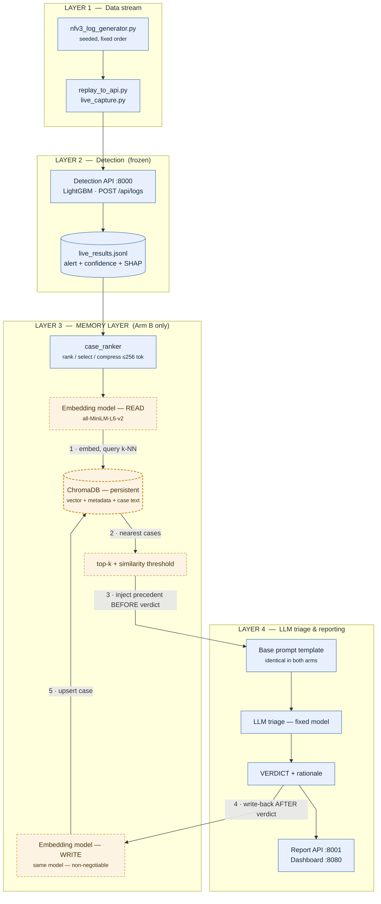

# MemSOC Docker Deployment

This directory contains the Docker deployment configuration for the MemSOC system.

## Architecture

MemSOC is deployed as three Docker services:

```text
                         ┌──────────────────────┐
                         │      Dashboard       │
                         │  React + Nginx :8080 │
                         └──────────┬───────────┘
                                    │
                                    ▼
                         ┌──────────────────────┐
                         │      Report API      │
                         │ FastAPI + Groq :8001 │
                         └──────────┬───────────┘
                                    │
                         Docker network / HTTP
                                    │
                                    ▼
                         ┌──────────────────────┐
                         │    Detection API     │
                         │ LightGBM + FastAPI   │
                         │        :8000         │
                         └──────────────────────┘

Host bind mounts:
  artifacts/model_outputs  <->  /app/artifacts/model_outputs
  artifacts/reports        <->  /app/artifacts/reports
```

## Services

| Service | Container | Host Port | Purpose |
|---|---|---:|---|
| detection | `memsoc-detection` | 8000 | ML-based network-flow detection |
| report | `memsoc-report` | 8001 | Stage 4 report generation and API |
| dashboard | `memsoc-dashboard` | 8080 | Web dashboard served by Nginx |

## Repository layout

The application lives in ONE source tree. `deploy/` holds only build and
orchestration files -- no application code, no per-service copies.

```text
src/memsoc/              the whole application, one importable package
├── paths.py             single source of truth for every path
├── api/                 EVERY HTTP endpoint in the system
│   ├── routes_detection.py    GET / , GET /health, POST /api/logs
│   ├── routes_reports.py      GET /health, GET /api/reports[/{name}]
│   ├── app_detection.py       ASGI app -> :8000
│   ├── app_reports.py         ASGI app -> :8001
│   └── schemas.py             shared request/response shapes
├── detection/           Layer 2 -- frozen LightGBM + SHAP
├── logstream/           Layer 1 -- deterministic NetFlow replay
├── triage/              Layer 4 -- LLM triage and report generation
├── memory/              Layer 3 -- the memory layer (research variable)
└── controller.py        interactive end-to-end workflow driver

models/                  the two LightGBM pickles (one copy)
dashboard/               React app (Vite)
deploy/                  Dockerfiles + compose ONLY
├── docker-compose.yml
├── detection.Dockerfile
├── report.Dockerfile
├── logstream.Dockerfile
├── dashboard.Dockerfile
└── controller.Dockerfile
requirements/            one file per deployable
artifacts/               all runtime output (gitignored)
tests/                   contract tests + manual/ smoke scripts
docs/
```

Every image builds from the **repository root**, so a Dockerfile cannot
drift from the code it ships, and `PYTHONPATH=/app/src` is the same in
every container.

## Prerequisites

- Docker Desktop with Linux containers enabled
- Docker Compose
- A valid Groq API key for report generation
- The MemSOC repository and required ML model files

Verify Docker:

```powershell
docker version
docker compose version
```

## Environment configuration

Keep secrets outside Git and outside Docker images.

There are three env files and they serve different purposes:

| File | Who reads it | Contents |
|---|---|---|
| `.env` (repo root) | Injected into the `report` and `controller` containers via `env_file` | `GROQ_API_KEY` only |
| `.env.developer` | Nothing in the deployment; load it into your own shell | Personal credentials, e.g. `GITHUB_PAT` |
| `deploy/.env` | Compose, for `${...}` interpolation | Published ports, `MEMSOC_HOST_DATA`. Template at `deploy/.env.example` |

Create `.env` in the repository root:

```text
GROQ_API_KEY=your_actual_groq_api_key
```

`env_file` passes **every** variable in that file to those containers, so
anything added to it is handed to them too. Credentials the application
does not use belong in `.env.developer`, which no service reads
(`docs/PRODUCT_BACKLOG.md` **BL-020**).

The repository `.gitignore` covers all of them:

```text
.env
.env.*
!.env.example
deploy/.env
```

Verify what a running container received, without printing the value:

```powershell
docker exec memsoc-report sh -c "env | grep -c '^GROQ_API_KEY='"
```

Compose passes the key to the report and controller services through
`env_file: ../.env` — not through `${GROQ_API_KEY}` interpolation, which
would read `deploy/.env` instead.

## Build images

Build each service using its small deployment directory as the build context:

```powershell
docker build -f .\Dockerfile -t memsoc-detection:latest .

docker build -f .\Dockerfile -t memsoc-report:latest .

docker build -f .\Dockerfile -t memsoc-dashboard:latest .
```

This is important: **do not use the repository root as the build context for the detection image**. The repository contains large datasets and generated files. The dedicated `deploy\detection` context keeps the build context small while still including the model files required by the detection image.

Check images:

```powershell
docker images | Select-String "memsoc"
```

## Start the complete deployment

From the repository root:

```powershell
docker compose -f .\deploy\docker-compose.yml up -d
```

Check status:

```powershell
docker compose -f .\deploy\docker-compose.yml ps
```

Expected services:

```text
memsoc-detection   Up
memsoc-report      Up
memsoc-dashboard   Up
```

## Health checks

Detection:

```powershell
Invoke-RestMethod http://localhost:8000/health
```

Expected:

```text
status
------
healthy
```

Report:

```powershell
Invoke-RestMethod http://localhost:8001/health
```

Report list:

```powershell
Invoke-RestMethod http://localhost:8001/api/reports
```

Dashboard:

```text
http://localhost:8080
```

## Container-to-container networking

The report container reaches the detection container by Compose service name:

```text
http://detection:8000/api/logs
```

Test the connection:

```powershell
docker exec memsoc-report python -c "import requests; r=requests.get('http://detection:8000/health', timeout=10); print(r.status_code); print(r.text)"
```

Expected:

```text
200
{"status":"healthy"}
```

## Stage 4 capture

`src/memsoc/triage/live_capture.py` runs on the host and sends generated flows to the Detection API. The default host endpoint is:

```text
http://127.0.0.1:8000/api/logs
```

Normal capture:

```powershell
python .\src\memsoc\triage\live_capture.py
```

Continuous capture:

```powershell
python .\src\memsoc\triage\live_capture.py --loop
```

Paced capture:

```powershell
python .\src\memsoc\triage\live_capture.py --interval 1.0
```

Explicitly reset previous captured results:

```powershell
python .\src\memsoc\triage\live_capture.py --reset
```

Results are appended to:

```text
artifacts/model_outputs/live_results.jsonl
```

## Report generation

Generate a report from captured results inside the Report container:

```powershell
docker exec memsoc-report python generate_report.py
```

For a small test snapshot:

```powershell
docker exec memsoc-report python generate_report.py --limit 10
```

Limit detailed findings:

```powershell
docker exec memsoc-report python generate_report.py --max-findings 25
```

Reports are written to:

```text
artifacts/reports/
```

The Report API exposes them through:

```text
GET /api/reports
GET /api/reports/{name}
```

## End-to-end workflow

```text
Generated network flows
        ↓
src/memsoc/triage/live_capture.py
        ↓
Detection API :8000
        ↓
LightGBM inference
        ↓
artifacts/model_outputs/live_results.jsonl
        ↓
Report container
        ↓
Groq analysis
        ↓
artifacts/reports/
        ↓
Report API :8001
        ↓
Dashboard :8080
```

## Pipeline with the memory layer

The four-layer architecture from `PROJECT_BRIEF.md` §4, showing where the memory
layer sits relative to verdict generation. Read the numbered edges in order:
retrieval (1-3) happens **before** the verdict, write-back (4-5) **after** it.

**Legend.** Solid blue = built and running today. Dashed amber = designed, not yet
implemented.



**Reading the memory loop:**

| Step | Edge | Phase |
|---|---|---|
| 1 | alert digest embedded, k-NN query issued | retrieval |
| 2 | nearest stored cases returned | retrieval |
| 3 | surviving cases injected into the prompt | retrieval, **before** verdict |
| 4 | verdict + rationale handed to the write path | write-back, **after** verdict |
| 5 | case upserted into ChromaDB | write-back |

**What is deliberately not in this diagram:**

- **The case schema** (which fields become embedded text vs. filterable metadata)
  and the **case-rendering template** are not drawn, because neither is settled
  yet — they are Phase 0 deliverables. ChromaDB appears as a single store node
  rather than a table of fields, so nothing here invents a schema.
- **Arm A is not drawn as a second path.** Adding a bypass edge around the memory
  layer introduced the only edge crossing in the layout. Arm A is this same
  diagram with Layer 3 switched off entirely: no retrieval, no injection, no
  write-back. Per §9, Arm B is Arm A plus a toggleable module, not a parallel
  codepath, so one diagram with a toggleable layer is the accurate picture.
- **The embedding model is shown twice** (READ and WRITE) to keep the retrieval
  and write-back phases visually separate. It is one model and must stay one
  model — a mismatch makes similarity meaningless (§3, §6).

**Open question flagged per `PROJECT_BRIEF.md` §5:** this diagram shows the LLM
verdict flowing into memory, *not* ground-truth labels. Ground truth remains the
evaluation oracle only. Whether confirmed ground-truth labels should also be
written to the store is still undecided — doing so would turn memory into an
oracle and inflate Arm B's results. That decision is the team's to make and is
not implied by this diagram.

## Data and volumes

The large generated dataset is kept outside the Docker images. The Report service uses host bind mounts for persistent Stage 4 output:

```text
artifacts/model_outputs -> /app/artifacts/model_outputs
artifacts/reports       -> /app/artifacts/reports
```

The detection image contains the ML models it needs at runtime.

## Stop and restart

Stop and remove the Compose containers/network:

```powershell
docker compose -f .\deploy\docker-compose.yml down
```

Start again:

```powershell
docker compose -f .\deploy\docker-compose.yml up -d
```

## Logs

```powershell
docker logs memsoc-detection --tail 100
docker logs memsoc-report --tail 100
docker logs memsoc-dashboard --tail 100
```

Follow Report logs:

```powershell
docker logs -f memsoc-report
```

## Rebuild after changes

Rebuild only the service that changed, then recreate the Compose service:

```powershell
docker build -f .\Dockerfile -t memsoc-detection:latest .
docker build -f .\Dockerfile -t memsoc-report:latest .
docker build -f .\Dockerfile -t memsoc-dashboard:latest .

docker compose -f .\deploy\docker-compose.yml up -d
```

## GitHub and Docker images

The Docker images are local Docker artifacts. They are **not uploaded to GitHub** simply because the repository is pushed.

Git should contain deployment source/configuration such as:

- Dockerfiles
- `docker-compose.yml`
- application source files
- runtime requirements
- required model files intended to be tracked

Do not commit:

- `.env` or real API keys
- Python virtual environments
- `node_modules`
- generated datasets
- runtime logs
- temporary test streams/backups
- Docker image layers

Before committing:

```powershell
git status
git status --ignored
```

## Troubleshooting

### `libgomp.so.1` error

The detection Dockerfile installs `libgomp1`, which is required by LightGBM. Rebuild the detection image if the Dockerfile was changed.

### Docker context/build-context problem

Build from the dedicated deployment directory as shown above. This prevents the multi-GB repository dataset from being sent to Docker during the detection build.

### Container name conflict

Inspect old containers:

```powershell
docker ps -a
```

Remove obsolete test containers:

```powershell
docker rm -f memsoc-detection-test memsoc-report-test memsoc-dashboard-test
```

### Dashboard does not show reports

Check the Report API:

```powershell
Invoke-RestMethod http://localhost:8001/api/reports
```

Check the shared files:

```powershell
docker exec memsoc-report sh -c "ls -lh /app/artifacts/model_outputs && echo '--- reports ---' && ls -lh /app/artifacts/reports"
```

## Deployment validation

The deployment has been validated with:

- Detection health check
- Real ML inference through the Dockerized Detection API
- Report health check
- Report-to-Detection Docker networking
- Shared `model_outputs` bind mount
- Shared `reports` bind mount
- Groq report generation from inside the Report container
- Dashboard served by Nginx
- Dashboard retrieving a newly generated report through the Report API
- End-to-end 10-flow capture test

A successful deployment should expose the three services on ports **8000, 8001, and 8080** and allow a newly generated report to appear in the dashboard.

## Security note

Never commit a real Groq API key. Keep secrets in the local `.env` file or another runtime secret mechanism, and keep `.env` excluded by `.gitignore`.
