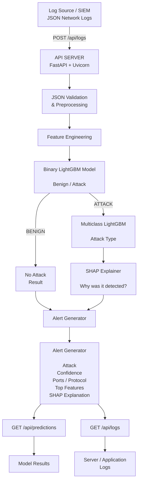

# MemSOC --- ML-Based Network Attack Detection API

## 1. Project Overview

MemSOC's machine-learning component will be deployed as a REST API that
receives network logs in JSON format, detects whether the traffic is
benign or malicious, identifies the attack category, generates a
SHAP-based explanation, and returns a structured alert.

This deployment focuses on the ML-based detection and explainability
component. It does not include or depend on the separate LLM or
memory-layer work.

The trained models are:

-   **Binary LightGBM:** determines whether traffic is benign or an
    attack.
-   **Multiclass LightGBM:** identifies the attack category when traffic
    is classified as an attack.
-   **SHAP:** explains the important features contributing to the
    multiclass prediction.

## 2. High-Level Architecture



## 3. API Endpoints

### 3.1 Log Ingestion

**Endpoint:** `POST /api/logs`

This endpoint receives network-flow logs in JSON format from a log
source, application, or SIEM.

Example:

``` json
{
    "L4_SRC_PORT": 11782,
    "L4_DST_PORT": 53,
    "PROTOCOL": 17,
    "IN_BYTES": 1200,
    "OUT_BYTES": 500,
    "MIN_TTL": 64,
    "MAX_TTL": 128
}
```

The complete production request will need to contain the features
required by the trained model.

The endpoint will:

1.  Receive the JSON log.
2.  Validate the input.
3.  Convert the input into the model's expected feature format.
4.  Run the detection pipeline.
5.  Generate the prediction and explanation.
6.  Store or generate the corresponding result.
7.  Return an acknowledgement/result.

`POST` is used because the client is sending JSON data to the server for
processing.

### 3.2 Application/Server Logs

**Endpoint:** `GET /api/logs`

This endpoint retrieves logs generated or stored by the application.

Example:

``` json
{
    "timestamp": "2026-08-10T18:10:00",
    "status": "processed"
}
```

The initial implementation only requires `GET /api/logs`.

### 3.3 Model Predictions

**Endpoint:** `GET /api/predictions`

This endpoint retrieves the results produced by the ML detection
pipeline.

Example:

``` json
{
    "is_attack": true,
    "attack": "Fuzzers",
    "confidence": 0.7228,
    "protocol": 6,
    "src_port": 48171,
    "dst_port": 445,
    "top_features": [
        "L4_SRC_PORT",
        "ICMP_TYPE",
        "SRC_TO_DST_IAT_MAX",
        "L4_DST_PORT",
        "LONGEST_FLOW_PKT"
    ],
    "shap_explanation": [
        {
            "feature": "L4_DST_PORT",
            "shap_value": 2.3646,
            "impact": "positive"
        }
    ]
}
```

## 4. ML Detection Pipeline

The deployed prediction pipeline will use the two existing LightGBM
models sequentially.

``` text
Incoming JSON
      |
      v
Preprocessing
      |
      v
Feature Engineering
      |
      v
Binary LightGBM
      |
      +---------------> Benign
      |                    |
      |                    v
      |                No Attack
      |
      +---------------> Attack
                           |
                           v
                    Multiclass LightGBM
                           |
                           v
                      Attack Type
                           |
                           v
                          SHAP
                           |
                           v
                     Final Alert
```

### Binary Classification

The binary model answers:

> Is the network traffic benign or an attack?

Output:

``` text
0 -> Benign
1 -> Attack
```

The current binary model has demonstrated approximately:

-   Accuracy: 1.0000
-   Precision: 0.9997
-   Recall: 0.9999
-   F1 Score: 0.9998

### Multiclass Classification

When the binary model identifies an attack, the multiclass LightGBM
model identifies:

-   Exploits
-   Fuzzers
-   Generic
-   Reconnaissance
-   DoS
-   Backdoor
-   Shellcode
-   Analysis
-   Worms

The current multiclass model achieves approximately **75.6% accuracy on
the full test set**. A practical 100-sample test achieved **72 correct
predictions out of 100**.

The model is considered ready for the deployment/testing phase, so
further model tuning is not currently planned.

## 5. SHAP Explainability

SHAP is used after an attack has been identified and classified.

Its purpose is to answer:

> Why did the model make this prediction?

Example:

``` json
{
    "feature": "MIN_IP_PKT_LEN",
    "shap_value": 0.7919,
    "impact": "positive"
}
```

A **positive** SHAP impact means the feature contributed toward the
model's predicted class.

A **negative** SHAP impact means the feature pushed the prediction away
from that class.

The final alert can therefore contain both the prediction and an
explanation of the important contributing features.

## 6. Alert Structure

The final alert should combine:

-   Attack/benign status
-   Attack category
-   Model confidence
-   Source port
-   Destination port
-   Protocol
-   Model top features
-   SHAP explanation

Example:

``` json
{
    "is_attack": true,
    "attack": "Exploits",
    "confidence": 0.6308,
    "src_port": 11782,
    "dst_port": 53,
    "protocol": 17,
    "top_features": [
        "L4_SRC_PORT",
        "ICMP_TYPE",
        "SRC_TO_DST_IAT_MAX",
        "L4_DST_PORT",
        "LONGEST_FLOW_PKT"
    ],
    "shap_explanation": [
        {
            "feature": "MIN_IP_PKT_LEN",
            "shap_value": 0.7919,
            "impact": "positive"
        }
    ]
}
```

## 7. Proposed Implementation Structure

``` text
MemSOC/
|
+-- main.py
|
+-- api/
|   +-- __init__.py
|   +-- server.py
|   +-- schemas.py
|
+-- models/
|   +-- binary_lightgbm.pkl
|   +-- multiclass_lightgbm.pkl
|
+-- src/
|   +-- preprocessing/
|   +-- features/
|   +-- models/
|   +-- explain/
|   +-- alerts/
|
+-- logs/
|   +-- application.log
|
+-- data/
|
+-- requirements.txt
```

The exact structure may be adjusted during implementation depending on
the current project layout.

## 8. Implementation Plan

### Phase 1 --- Build the API Server

Use:

-   FastAPI
-   Uvicorn

Install:

``` powershell
pip install fastapi uvicorn
```

Create the basic API server and verify that it starts correctly.

### Phase 2 --- Implement Log Ingestion

Create:

``` text
POST /api/logs
```

Initially, the endpoint will simply receive and validate JSON.

Test it through FastAPI's automatically generated Swagger interface.

### Phase 3 --- Load the Trained Models

Load:

``` text
models/binary_lightgbm.pkl
models/multiclass_lightgbm.pkl
```

The models should be loaded once when the server starts rather than
reloaded for every request.

### Phase 4 --- Production Feature Processing

The training pipeline currently processes the complete dataset.

For deployment, create an input-processing path that converts one
incoming JSON network flow into the same feature structure expected by
the trained models.

This is an important step because production inputs must match the
model's training feature representation.

### Phase 5 --- Connect Binary and Multiclass Models

Implement:

``` text
JSON
 |
 v
Binary model
 |
 +--> Benign -> stop
 |
 +--> Attack
       |
       v
   Multiclass model
```

### Phase 6 --- Integrate SHAP

Reuse the existing `SHAPExplainer`.

For an attack prediction:

``` text
Attack
 |
 v
Multiclass prediction
 |
 v
SHAP explanation
 |
 v
Alert
```

### Phase 7 --- Store Results

For the first deployment version, simple storage can be used:

``` text
logs/application.log
data/predictions.json
```

A database such as SQLite or PostgreSQL can be introduced later if
required.

### Phase 8 --- Implement Retrieval Endpoints

Implement:

``` text
GET /api/logs
GET /api/predictions
```

### Phase 9 --- API Testing

Test the complete flow:

``` text
POST JSON
    |
    v
Binary detection
    |
    v
Multiclass classification
    |
    v
SHAP explanation
    |
    v
Alert generation
    |
    v
GET prediction
```

Testing can initially be performed using:

-   FastAPI Swagger UI
-   Postman
-   Python requests

### Phase 10 --- Server Deployment

Only after the local API is stable should the system be deployed to a
server.

Possible deployment flow:

``` text
Client / SIEM
      |
      v
FastAPI
      |
      v
Uvicorn
      |
      v
ML Models
      |
      v
SHAP
      |
      v
Alert / API Response
```

Containerization, authentication, databases, reverse proxies,
monitoring, and other production features can be added after the core
API is working.

## 9. Scope

This implementation focuses on:

-   Network-log ingestion
-   ML-based binary attack detection
-   Multiclass attack classification
-   SHAP explainability
-   Alert generation
-   REST API deployment
-   Application/server logging
-   Prediction retrieval

It **does not implement the separate LLM or memory layer**. Those
components belong to another part of the overall project and are outside
the scope of this ML deployment.

## 10. Final Target

The final working system should allow an external log source to perform:

``` text
POST /api/logs
       |
       v
   Send JSON
       |
       v
   ML Detection
       |
       v
   Attack Classification
       |
       v
   SHAP Explanation
       |
       v
   Alert Generated
       |
       +-------------------+
       |                   |
       v                   v
GET /api/logs       GET /api/predictions
```

### Immediate Goal

> **Build a FastAPI service around the existing Binary LightGBM,
> Multiclass LightGBM, SHAP, and Alert Generator components without
> changing the trained models.**
