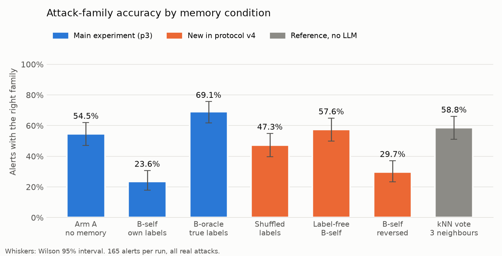
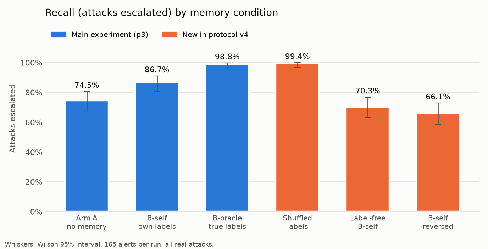
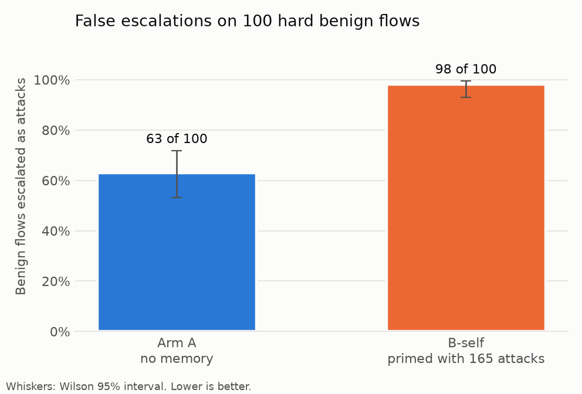
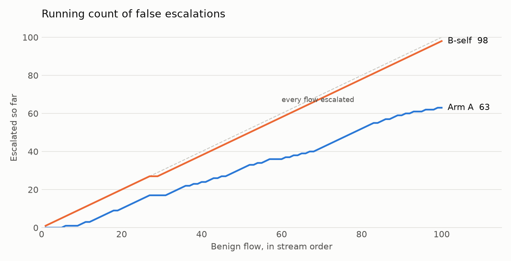
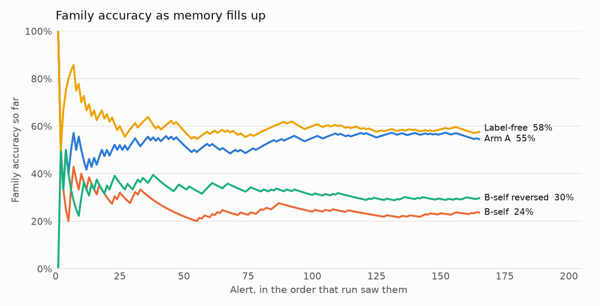
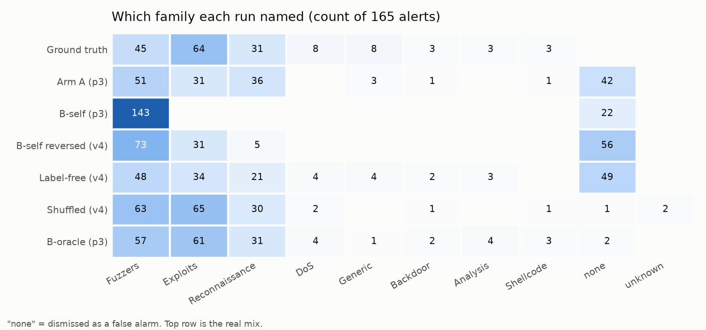

# Results of the 5 protocol v4 tests

> **Supplementary, protocol v4.** Gemma 4 26B (`gemma-4-26b-a4b-it`), run 2026-10-30 to 2026-10-31 from the
> `memsoc-protocol-v4` tag. The frozen p3 runs remain the main experiment; every p3 number below is copied
> from the verified p3 package, not re-run.
>
> **What was fixed before any run:** [`protocol-v4-preregistration.md`](../status/protocol-v4-preregistration.md)
> (hypotheses in §5, decisions in §8). **Plan:** [`protocol-v4-execution-plan.md`](../work-split/protocol-v4-execution-plan.md).

---

## In one minute

| Test | Question | Answer |
|---|---|---|
| 1. Shuffled labels | Does B-oracle win because its labels are **correct**? | **Yes.** With wrong families, family accuracy fell from 69.1% to 47.3%, below no memory (54.5%). |
| 2. Label-free memory | If memory stores no family, does B-self stop copying bad families? | **Yes, but recall fell.** Family accuracy rose from 23.6% to 57.6%, while recall dropped to 70.3% (Arm A 74.5%). |
| 3. Hard-benign, Arm A | How often does Gemma escalate harmless traffic with no memory? | **63 of 100.** |
| 4. Hard-benign, B-self | Does a memory full of attacks make that worse? | **Yes: 98 of 100.** The clearest harm in all five tests. |
| 5. Reversed order | Was B-self's p3 failure just the alert order? | **The family harm is not.** Family accuracy stayed low (29.7%). But reversed recall fell *below* Arm A, so the p3 pattern did not repeat in full. |

**All five runs finished and passed their verify checks.** The p3 reference copy is unchanged; all its
checksums still match.

---

## The setup

| Item | Value |
|---|---|
| Model | `gemma-4-26b-a4b-it`, temperature 0, via the Gemini API |
| Attack alerts | The same 165 p3 alerts, all real attacks |
| Benign flows | 100 held-out benign flows with the highest detector scores, near-duplicates removed |
| Memory | ChromaDB + `all-MiniLM-L6-v2`, top 3 retrieved, earlier alerts only |
| Prompt | p3 template. The only change is the label-free precedent block (approved, BL-170). |
| Scoring | The unchanged `memsoc.triage.score_verdicts` |
| Tests | Exact two-sided McNemar, paired alert by alert; Wilson 95% intervals; Holm across the five hypotheses |

| # | Run id | Memory condition | Alerts | Finished | Verify |
|---|---|---|---|---|---|
| 1 | `bshuf-gemma4-26b-p4` | B-oracle writes, families shuffled on read | 165 | 2026-10-30 19:51 | PASS |
| 2 | `bnolabel-gemma4-26b-p4` | B-self, no family stored or shown | 165 | 2026-10-30 21:37 | PASS |
| 3 | `armA-benign-gemma4-26b-p4` | Arm A (no memory) | 100 | 2026-10-30 23:16 | PASS |
| 4 | `bself-benign-gemma4-26b-p4` | B-self, starts from the p3 store (165 attack cases) | 100 | 2026-10-31 15:04 | PASS |
| 5 | `bself-rev-gemma4-26b-p4` | B-self on the reversed alert order, empty store | 165 | 2026-10-31 16:38 | PASS |

---

## Hypotheses: the verdict

"Significant" means Holm-adjusted p < 0.05 (§8.2). **Fixed** = alerts the new run got right that the
comparison got wrong; **broken** = the opposite.

| # | Hypothesis | Comparison | Fixed / broken | Raw p | Holm p | Result |
|---|---|---|---|---|---|---|
| **H1** | B-oracle names families better because its labels are correct | Shuffled vs B-oracle, family | 9 / 45 | 7.3e-7 | 2.2e-6 | **Supported** |
| **H2a** | Label-free memory keeps the recall gain | Label-free vs Arm A, recall | 13 / 20 | 0.30 | 0.30 | **Contradicted**: recall is *lower* than Arm A (70.3% vs 74.5%), not higher |
| **H2b** | Label-free memory removes the family harm | Label-free vs B-self, family | 60 / 4 | 7.4e-14 | 3.7e-13 | **Supported** |
| **H3** | The p3 B-self result is not just the alert order | Reversed vs Arm A: recall **and** family | recall 14 / 28; family 7 / 48 | recall 0.044; family 1.3e-8 | 0.087 | **Contradicted**: family accuracy is lower, as in p3, but recall went *down* instead of up |
| **H4** | A memory of attacks makes harmless traffic look like attacks | Benign B-self vs Arm A, false escalation | 0 / 35 | 5.8e-11 | 2.3e-10 | **Supported** |

**How H3's p was formed:** H3 needs two differences in set directions, so its p is the larger of the two
tests (an intersection-union test). That rule was not written in the note; it is our choice and is stated
here. It makes no difference to the result: the recall difference points the wrong way, so H3 fails
whatever the p.

---

## Test 1: Shuffled-label memory

**What changed:** the same 3 cases B-oracle would retrieve, but each case's attack family is swapped for a
true family drawn at random from the cases stored so far. The verdict (attack) never changes, because all
165 alerts are attacks.

| Run | Family accuracy | Recall |
|---|---|---|
| B-oracle (p3) | 69.1% (61.7–75.6) | 98.8% |
| **Shuffled (v4)** | **47.3% (39.8–54.9)** | **99.4%** |
| Arm A (p3) | 54.5% (46.9–62.0) | 74.5% |

- **Family accuracy needs the right label.** Shuffling broke 45 alerts B-oracle got right and fixed only 9.
  The result is even below no memory.
- **Recall needs only "this was an attack".** Recall stayed at 99.4% because every precedent still said
  "attack". So B-oracle's recall gain comes from the verdict, and its family gain from the family.
- **Disclosure:** 133 of the 492 replacements (27%) drew the same family as the original by chance, so
  shuffled memory was partly correct (BL-172).

---

## Test 2: Label-free memory

**What changed:** B-self, but each stored case keeps only the alert text, the model's own verdict and its
confidence. The `Attack category:` and `Reasoning:` lines are left out of the precedent block.

| Run | Family accuracy | Recall | Dismissed attacks |
|---|---|---|---|
| B-self (p3) | 23.6% (17.8–30.7) | 86.7% (80.6–91.0) | 22 |
| **Label-free (v4)** | **57.6% (49.9–64.9)** | **70.3% (62.9–76.7)** | **49** |
| Arm A (p3) | 54.5% (46.9–62.0) | 74.5% (67.4–80.6) | 42 |

- **The family harm came from the stored family.** Removing it fixed 60 alerts and broke 4 (H2b).
  Label-free ends slightly above Arm A.
- **The recall gain did not survive.** Without families, memory no longer pushed towards "attack"; recall
  is a little below Arm A, with no detectable difference (H2a).

---

## Tests 3 and 4: Hard-benign, attack-primed stream

**What changed:** 100 harmless flows the detector found most suspicious, each shown as an alert. Arm A sees
them with no memory. B-self starts from a copy of its p3 memory (165 attack cases) and keeps writing back.

| Run | Escalated (wrong) | Dismissed (right) | Inconclusive | False-escalation rate |
|---|---|---|---|---|
| Arm A | 63 | 37 | 0 | **63% (53.2–71.8)** |
| B-self, primed | 98 | 2 | 0 | **98% (93.0–99.4)** |

- **Memory made it much worse.** B-self broke 35 flows Arm A got right and fixed none (H4).
- **It copied the memory's family.** B-self called 95 of its 98 escalations "Fuzzers", the family that fills
  its p3 memory. Arm A's escalations were mostly "Exploits" (49 of 63).
- **Arm A's 63% is high too.** Every benign alert shows an attack score of 1.0 (§8.1, BL-181), so even without
  memory, Gemma escalated most of them.
- **The detector's own false alarms:** 3 of the 100 flows really scored ≥ 0.5. Arm A escalated 2 of them,
  B-self all 3.
- **Disclosure:** 74 of the "hardest 100" sit on the detector's floor score and were chosen by a seeded
  tie-break (§8.1, BL-180). They are not harder than other benign traffic.

---

## Test 5: Reversed order

**What changed:** B-self on the exact reverse of the 165-alert order, from an empty store. The p3 order starts
with a Fuzzers alert; the reversed order starts with an Exploits alert.

| Run | Family accuracy | Recall | Dismissed attacks |
|---|---|---|---|
| B-self, p3 order | 23.6% | 86.7% | 22 |
| **B-self, reversed (v4)** | **29.7% (23.3–37.1)** | **66.1% (58.5–72.8)** | **56** |
| Arm A (p3) | 54.5% | 74.5% | 42 |

- **The family harm is not an order effect.** Reversed B-self is still far below Arm A (7 fixed, 48 broken).
- **The recall gain did not repeat.** Reversed B-self dismissed more attacks than Arm A, not fewer. So p3's
  recall gain for B-self may depend on the order, and the paper should say so.
- **It still locks onto one family.** Despite starting with Exploits, reversed B-self named Fuzzers 73 times
  (see the family mix below).

---

## Which family each run named

The top row is the real mix. B-self in p3 named Fuzzers for all 143 escalations. Reversed B-self leans the
same way (73 Fuzzers). Label-free, shuffled and B-oracle spread across families much like the real mix.

---

## First 10 alerts vs the rest

As in p3, the first 10 alerts (memory nearly empty) are reported apart from the other 155.

| Run | Recall, first 10 | Recall, rest | Family, first 10 | Family, rest |
|---|---|---|---|---|
| Arm A (p3) | 60% | 75.5% | 50% | 54.8% |
| B-self (p3) | 80% | 87.1% | 40% | 22.6% |
| B-oracle (p3) | 80% | 100% | 60% | 69.7% |
| Shuffled (v4) | 90% | 100% | 40% | 47.7% |
| Label-free (v4) | 70% | 70.3% | 70% | 56.8% |
| Reversed (v4) | 60% | 66.5% | 30% | 29.7% |

The "first 10" rows rest on 10 alerts each and are too small to compare on their own.

---

## Reference: nearest-neighbour vote (no LLM)

A 3-neighbour vote over true labels, using the retrieval p3 actually logged, gets **97 of 165 families
right (58.8%)**. Only B-oracle (69.1%) beats it. Label-free (57.6%) comes
close; every other condition falls below it. This is a reference row, not a hypothesis test (§3.5).

---

## Things to state alongside these results

1. **One run per condition.** Each number is a single run at temperature 0, not an average.
2. **Benign B-self was paused once.** It stopped at 6 of 100 on 2026-10-30 23:21 on request and resumed at
   14:10 the next day from the saved verdicts (store held 171 cases as expected). Nothing was re-run (§6.3).
3. **Network retries.** Some calls hit network errors and were retried automatically with the same inputs.
   Every run has exactly one verdict per alert.
4. **The benign score line shows 1.0** for every benign alert (§8.1, BL-181).
5. **Shuffled memory is family-only and partly right by chance** (27% of replacements, BL-172).
6. **Mean time per call:**
   - shuffled 35.1 s
   - label-free 26.6 s
   - reversed 25.3 s
   - benign Arm A 45.6 s
   - benign B-self 28.8 s

---

## Files in this folder

| File | What it is |
|---|---|
| `README.md` | This report |
| `figures/01-family-accuracy.png` | Family accuracy, all conditions, with the kNN reference |
| `figures/02-recall.png` | Recall, all conditions |
| `figures/03-benign-false-escalation.png` | False escalations on the 100 benign flows |
| `figures/04-benign-cumulative.png` | Running count of false escalations along the benign stream |
| `figures/05-family-mix.png` | Which family each run named, against the real mix |
| `figures/06-family-accuracy-over-stream.png` | Family accuracy as memory fills up |
| `figures/results.json` | Every number in this report, as computed |

The raw verdicts and memory stores are in `artifacts/runs/` and `artifacts/memory/` under the run ids above.
They are not committed (gitignored).
