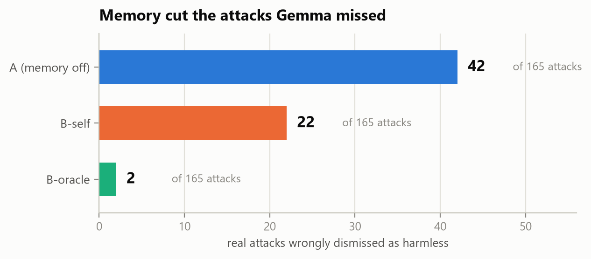
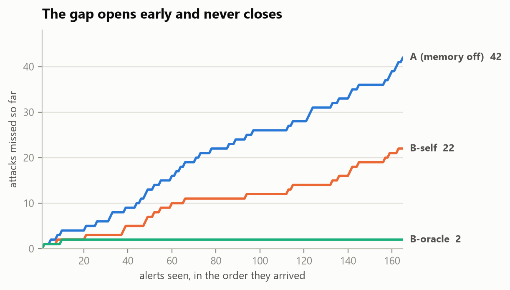
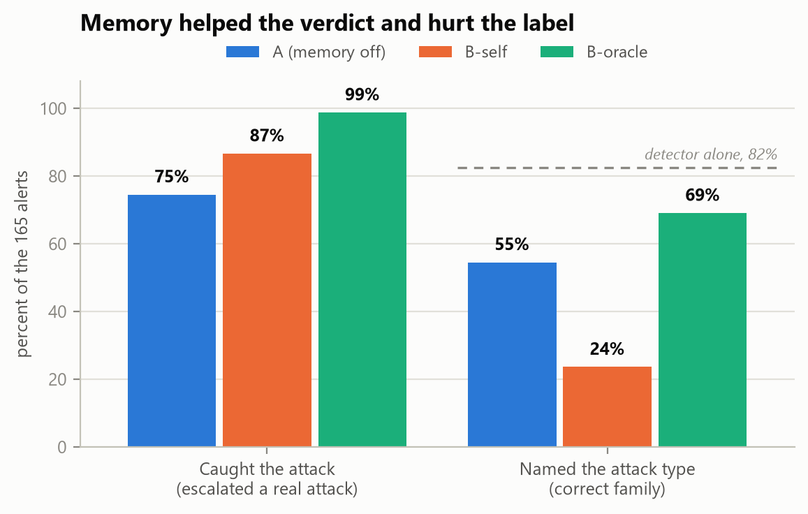
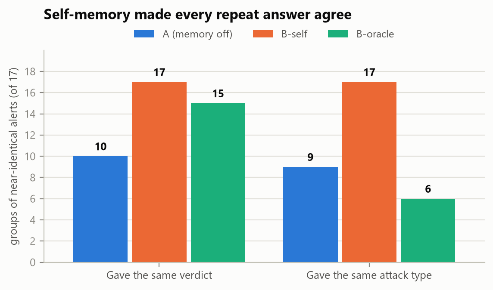

# Gemma 4 26B — the first complete three-arm result

> **Reproduced copy.** Authored by Aryan (Tester M), originally committed as
> `docs/status/gemma-p3-results.md` on the `origin/aryan` branch (commit
> `d08233c`), which is not merged into `main`. Copied here verbatim, with only
> the figure/script paths below updated to this folder's own layout — the
> text and numbers are unchanged.
>
> **Run:** 165 alerts × 3 arms = 495 verdicts, 2026-10-17, 16:49–22:07 (5 h 18 m).
> **Model:** `gemma-4-26b-a4b-it` via AI Studio, temperature 0, output cap 16,384.
> **Protocol:** v3, commit `10e1010`, tag `memsoc-protocol-v3` (doc not copied here).
> **Run ids:** `armA-gemma4-26b-p3`, `bself-gemma4-26b-p3`, `boracle-gemma4-26b-p3`.
> **Integrity:** `--verify` passed **17 of 17** checks, including "Arm A retrieved nothing",
> "Arm A created no memory store" and "retrieval matches the reference machine (0 of 165 alerts differ)".
> **Scoring:** every number below comes from the unchanged `memsoc.triage.score_verdicts`.
> **Figures:** in this same folder, regenerated by [`build_p3_figures.py`](./build_p3_figures.py).

---

## 1. The finding in one sentence

**Giving the model a memory of its own past cases cut the attacks it missed almost in half — from 42 to 22 out of 165 — and at the same time made it substantially *worse* at naming what kind of attack it had found.**

Both halves of that sentence are statistically solid, and the second half is the more interesting one.

Every term used below — *arm*, *verdict*, *recall*, *self-memory*, *p-value* — is defined in §2.

---

## 2. The words used in this report

Each term is defined once here, in plain language, so the rest of the report can stay short.

### The setup

| Term | What it means |
|---|---|
| **Alert** | One piece of network traffic the detector flagged as suspicious. This run used 165 of them. |
| **The detector** | The machine-learning model earlier in the pipeline. It decides what becomes an alert and makes its own guess at the attack family. It is frozen — never retrained, never tuned, identical in all three arms. |
| **Ground truth** | The correct answer, known in advance because the dataset is labelled. Used for marking, and shown to the model only in B-oracle. |
| **Arm** | One of the three setups being compared. Same model, same prompt, same code — the only thing that changes is what the model may remember. |
| **Memory (the case store)** | A record of alerts already handled. For each new alert the system finds the 3 most similar past ones and shows them to the model. |
| **Self-memory** (`B-self`) | Memory holding the model's **own** past answers, right or wrong, with nobody correcting them. This is the only version that could run in a real SOC, because in real life no one hands you the answer key. |
| **Oracle memory** (`B-oracle`) | The same memory, but holding the **correct** answers. Not deployable — it needs ground truth. It exists only as a ceiling, to show what memory could do if its contents were perfect. |

### The two questions the model answers

| Term | What it means |
|---|---|
| **Verdict** | Real attack, or false alarm. `true_positive` means "this is real", `false_positive` means "this is a false alarm". |
| **Escalate / dismiss** | What a verdict does in practice: hand the alert to a human analyst, or close it. |
| **Attack family** (the *label*) | What kind of attack it is — Fuzzers, Exploits, Reconnaissance, DoS, and so on. |
| **Inconclusive** | The model declined to call it either way. This never happened in this run. |

### The scores

| Term | What it means |
|---|---|
| **True positive (TP)** | A real attack, correctly escalated. |
| **False negative (FN)**, a *missed attack* | A real attack, wrongly dismissed as harmless. The expensive mistake, and the one this report is mostly about. |
| **False positive (FP)** | Harmless traffic, wrongly escalated. Always 0 here — see limit 1 in §7. |
| **True negative (TN)** | Harmless traffic, correctly dismissed. Always 0 here, for the same reason. |
| **Recall** | Out of all the real attacks, the share the model caught. **The main score in this run.** |
| **Precision** | Out of everything the model escalated, the share that were really attacks. **Carries no information in this run** — with no harmless traffic present, it cannot be anything but 1.000. |
| **F1** | One number balancing precision and recall. Because precision is meaningless here, so is F1; it is listed for completeness only. |
| **Family accuracy** | How often the model named the attack family that ground truth gives. |
| **Agreement with detector** | How often the model's family matched the detector's guess. **Not** a measure of being right — it only shows how often the model went along with the detector. |
| **Near-duplicate group** | A set of alerts that look alike: same detector label, same destination port, same protocol. There are 17 such groups. A steady analyst would give every member of a group the same answer. |
| **Latency** | How long the model took per alert, in seconds. |

### Reading the statistics

| Term | What it means |
|---|---|
| **Paired comparison** | All three arms answered the same 165 alerts, so they can be compared alert by alert, not just rate against rate. This is much more sensitive than comparing two percentages. |
| **McNemar test** | Looks only at the alerts where two arms disagreed, and asks whether those disagreements lean one way further than coin-flipping would explain. |
| **p-value** | The chance of seeing a lean this lopsided if memory really made no difference at all. Smaller means more convincing. Below 0.05 is the usual bar; every p-value in this report is far below it. |
| **Cold start** | The opening stretch of a run, when memory is still almost empty and has little worth retrieving. |

---

## 3. What was compared

Each of the 165 alerts was triaged three times, by the same model, with the same prompt template, through the same code. The only thing that changed was what the model was allowed to remember.

| Arm | What it sees | What goes into memory | What it represents |
|---|---|---|---|
| **A (memory off)** | the alert alone | nothing; no store is ever created | the baseline |
| **B-self** | the alert + its 3 most similar past alerts, each tagged with **the model's own earlier verdict** | its own verdict, right or wrong | **the deployable system** — the headline |
| **B-oracle** | the alert + the same 3 past alerts, each tagged with **the true label** | ground truth | a declared **ceiling**, never the headline |

For every alert the model answers two separate questions:

1. **Is this a real attack or a false alarm?** (the verdict)
2. **What family of attack is it?** (the label — Fuzzers, Exploits, Reconnaissance, DoS…)

Keep those two apart. Memory moved them in opposite directions.

---

## 4. Result 1 — memory cut missed attacks roughly in half

A *missed attack* is the costly error: a genuine intrusion waved through as harmless.



```
A (memory off)  ██████████████████  42 missed
B-self          ██████████           22 missed
B-oracle        █                     2 missed
                └─ of 165 real attacks
```

| Arm | Caught | **Missed** | Caught as a rate |
|---|---:|---:|---:|
| A (memory off) | 123 | **42** | 74.5% |
| B-self | 143 | **22** | 86.7% |
| B-oracle | 163 | **2** | 98.8% |

No arm ever returned "inconclusive", so every one of the 495 answers is a decisive call.

**Is it real, or luck?** A paired exact McNemar test — which looks only at the alerts where the two arms disagreed — says real:

| Comparison | Memory fixed it | Memory broke it | p |
|---|---:|---:|---:|
| B-self vs A, catching attacks | **21** | 1 | 0.000011 |
| B-oracle vs A, catching attacks | **40** | 0 | 0.0000000000018 |

B-self fixed 21 alerts that the baseline got wrong and broke exactly **one**. That is a lopsided trade in memory's favour, not noise.

### The effect appears early and holds



The orange line sits below the blue one from roughly the 20th alert onward and the gap keeps widening — memory isn't winning on a lucky patch at the end, it's steadily better once it has a few cases to draw on.

Note where B-oracle's two misses are: both land in the **first ten alerts**, while the store is still nearly empty. After that it is flat for 155 straight alerts. That is the cold-start cost of an empty memory, isolated.

---

## 5. Result 2 — and it made the attack *labels* worse



```
Named the attack family correctly
A (memory off)  ████████████          54.5%
B-self          █████                 23.6%   <-- worse than no memory
B-oracle        ███████████████       69.1%
detector alone  ██████████████████    82.4%
```

| Arm | Family named correctly | vs the detector on the same alerts |
|---|---:|---:|
| A (memory off) | 54.5% | −27.9 pts |
| B-self | **23.6%** | −58.8 pts |
| B-oracle | 69.1% | −13.3 pts |
| *the detector alone* | *82.4%* | — |

Self-memory more than halved label accuracy, and the McNemar test is emphatic about it:

| Comparison | Memory fixed it | Memory broke it | p |
|---|---:|---:|---:|
| B-self vs A, naming the family | 5 | **56** | 0.0000000000057 |

Fifty-six alerts that the baseline labelled correctly were labelled *incorrectly* once the model could see its own past answers.

### Why: it is copying its own homework

The dataset contains groups of near-identical alerts — same detector label, same destination port, same protocol. Those are the cases where a consistent analyst should give a consistent answer.



| Arm | Same verdict across a group | Same family across a group |
|---|---:|---:|
| A (memory off) | 10 of 17 | 9 of 17 |
| B-self | **17 of 17** | **17 of 17** |
| B-oracle | 15 of 17 | 6 of 17 |

B-self achieved **perfect** consistency: every group of near-identical alerts got one answer. And its accuracy on those labels collapsed at the same time.

That is the mechanism, stated plainly: **memory does not make the model think harder, it makes the model agree with itself.** Whatever family it assigned to the first alert of a kind gets retrieved and repeated for every similar alert afterwards. When the first guess was right, the repetition is free accuracy. When it was wrong, the error is copied forward indefinitely.

The confirming evidence is B-oracle. Same retrieval, same prompt, same model — only the stored labels are correct — and label accuracy goes to 69.1%. **Memory itself is not the problem. Unchecked memory is.**

A related signal: B-self's agreement with the detector fell to 29.7%, against 65.5% for the baseline. It overruled the detector on most alerts without being more right, which is worse than simply echoing it.

---

## 6. Result 3 — memory also made it twice as fast

```
Mean seconds per alert
A (memory off)  ████████████████████  40 s
B-self          ███████████           22 s
B-oracle        █████████████         27 s
```

| Arm | Mean latency |
|---|---:|
| A (memory off) | 40.4 s |
| B-self | 21.5 s |
| B-oracle | 27.1 s |

This was not expected. Retrieval normally *costs* latency — here it halved it. A relevant past case gives the model a starting point, so it reasons from scratch far less. Memory bought accuracy and speed together.

---

## 7. What this run cannot tell you

These limits are not hedging; they bound what the result can be used to claim.

1. **There is no benign traffic in the dataset.** All 1,135 detector-flagged alerts are real attacks. So true negatives and false positives are structurally zero, and the `precision 1.000` in the raw scorer output is an artefact — you cannot raise a false alarm when nothing innocent is present. **We measured missed attacks only. We learned nothing about alert fatigue**, which is the thing a real SOC cares about most. Any claim that memory "reduces false positives" is unsupported by this run.
2. **No arm beat the detector at naming families.** The best, B-oracle at 69.1%, is still 13 points below the frozen detector's 82.4% on the same alerts. On the Option A primary metric, the LLM layer is not yet additive.
3. **One model, one run, one ordering.** No repeats, no seeds varied, so there are no error bars on the arm-level rates. The McNemar tests are paired and therefore robust to that, but they test *this* ordering of *these* alerts.
4. **B-oracle is a ceiling, not a result.** It is fed the answer key. It exists to separate "retrieval found the right neighbours" from "the model used them well", and it must never be reported as system performance.
5. **165 of 1,135 alerts.** The first 165 in stream order, per protocol v3 §2 — not a random sample of the stream.

---

## 8. Every number, in one table

| | A (memory off) | B-self | B-oracle |
|---|---:|---:|---:|
| True positives | 123 | 143 | 163 |
| False negatives (missed attacks) | 42 | 22 | 2 |
| False positives | 0 | 0 | 0 |
| True negatives | 0 | 0 | 0 |
| Inconclusive | 0 | 0 | 0 |
| Precision *(see §7, limit 1)* | 1.000 | 1.000 | 1.000 |
| Recall | 0.745 | 0.867 | 0.988 |
| F1 | 0.854 | 0.929 | 0.994 |
| Family accuracy | 0.545 | 0.236 | 0.691 |
| Detector family accuracy, same alerts | 0.824 | 0.824 | 0.824 |
| Agreement with detector | 0.655 | 0.297 | 0.812 |
| Near-duplicate groups, uniform verdict | 10/17 | 17/17 | 15/17 |
| Near-duplicate groups, uniform family | 9/17 | 17/17 | 6/17 |
| Mean latency | 40.4 s | 21.5 s | 27.1 s |
| LLM requests | 165 | 165 | 165 |

**Run health:** 0 API errors, 0 truncations, 0 parse failures across all 495 calls. 69 `server busy (500)` responses were absorbed by the client's own retry without reaching the protocol layer — the protocol v3 fixes (BL-126) did their job.

---

## 9. What this means for the next step

- **The headline claim the project can make is about recall, not precision.** "Self-memory cut missed attacks from 42 to 22 (p = 1.1 × 10⁻⁵)" is supported. "Memory reduces false positives" is not testable on this dataset.
- **The label regression is a finding to publish, not a bug to tune away.** It is a clean, statistically strong demonstration of error propagation through self-memory, and the B-oracle contrast isolates the cause. Per CLAUDE.md the prompt must not be tuned to make it go away.
- **An obvious follow-up is suggested by the data but not performed here:** B-self's failure is concentrated in the *label* it copies, not the *verdict*. Whether storing the verdict without the family label keeps the recall gain and drops the label harm is an open question. It would change the case schema (decisions.md C1), so it needs approval, not initiative.
- **Benign traffic would have to be added to the stream** before anything can be said about false alarms.

---

## Reproducing the figures

```
python docs/status/aryan-gemma-results/build_p3_figures.py
```

It reads the three `triage_verdicts.jsonl` files, takes every metric from the unchanged `memsoc.triage.score_verdicts`, and rewrites the four PNGs beside itself. It needs `numpy` and `matplotlib` only — no embedding model, no vector store, no network, about two seconds.

**Note on this copy:** only the write-up, the generator script and the already-rendered
PNGs were brought into this folder — the underlying Gemma run data
(`artifacts/runs/{armA,bself,boracle}-gemma4-26b-p3/`) was **not** copied here, so
running the command above from this repo will fail until that data is also present.
The figures shown above are the ones already rendered on the original machine.

Figures and generator live together here, the same arrangement as the original
`docs/status-assets/` (and `docs/design-assets/`), so the images resolve for anyone
who opens this folder.

These figures were **not** produced by `notebooks/retrieval-quality.ipynb`, which currently cannot be executed to completion — its embedding cell dies natively (**BL-132**). The results figures need no embeddings, which is why this path works while the notebook is blocked. The notebook's own retrieval figures (2–6) remain stale until BL-132 is fixed.

---

*Compiled 2026-10-18 from `artifacts/runs/{armA,bself,boracle}-gemma4-26b-p3/triage_verdicts.jsonl`.
Supersedes nothing — this is the first complete three-arm run on a model that is not at the floor.
Prior runs and the flash-lite stand-in are in [`testing-results-to-date.md`](./testing-results-to-date.md).*
