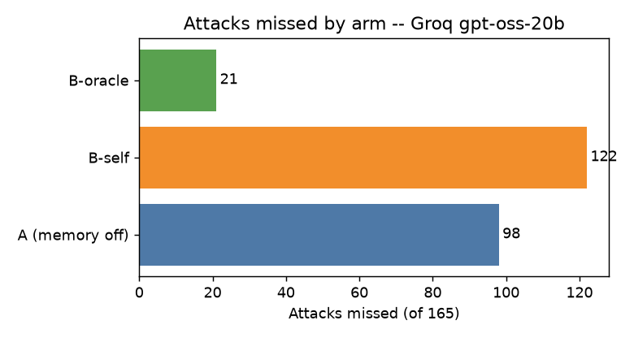
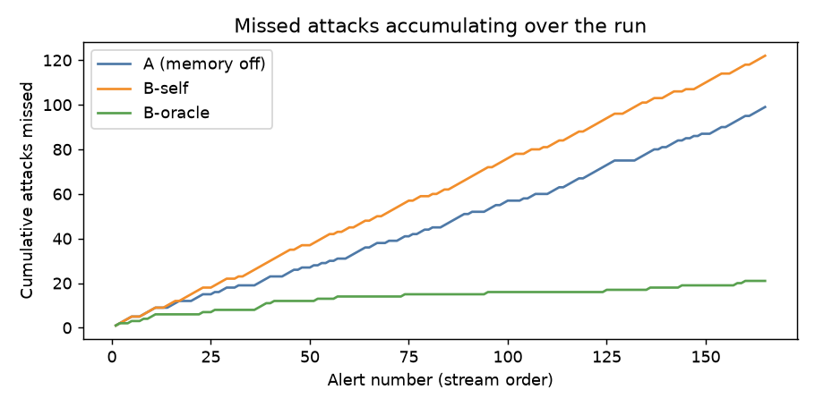
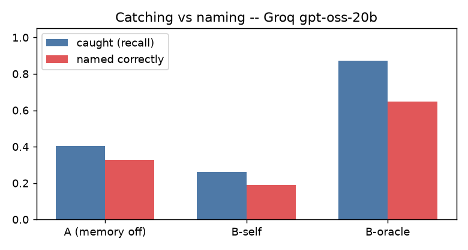
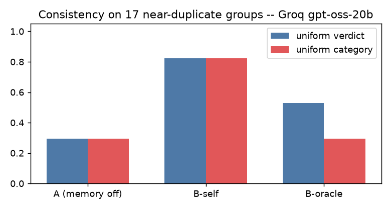

# Groq gpt-oss-20b — the first complete result on protocol v1

> **Run:** 165 alerts × 3 arms = 495 verdicts, 2026-10-17 to 2026-10-20 (intermittent —
> spread over several days by Groq's free-tier daily request quota, plus deliberate
> pauses and two API key swaps; not a single continuous session).
> **Model:** `openai/gpt-oss-20b` via Groq, temperature 0, output cap 6,000 tokens (standard calls).
> **Protocol:** **v1**, commit `873262d`, tag `memsoc-protocol-v1` — **not** the v3 protocol
> Gemma's run used (see [`gemma-p3-results.md`](./gemma-p3-results.md)). This run predates v3 and was
> not re-cut onto it.
> **Run ids:** `armA-gptoss20b-p1`, `bself-gptoss20b-p1`, `boracle-gptoss20b-p1`.
> **Integrity:** `--verify` passed **17 of 17** checks, including "Arm A retrieved nothing",
> "Arm A created no memory store" and "retrieval matches the reference machine (0 of 165 alerts differ)".
> **Scoring:** every number below comes from the unchanged `memsoc.triage.score_verdicts`.
> McNemar p-values are computed by a separate, read-only script (`score_verdicts.py` does
> not yet have this built in — see §10), the same situation the Gemma write-up was in.
> **Figures:** `docs/status-assets/groq-*.png`.

---

## 0. Two disclosed deviations from the frozen protocol

Protocol v1 does not retry Groq's `400 json_validate_failed` error at all — its own
troubleshooting table says to stop and not retry. This run deviated from that,
with the repo owner's explicit, in-the-moment approval, twice:

1. **`llm_client.py`** — added a retry specifically for `json_validate_failed`
   (a reasoning model exhausting its token budget before emitting any content),
   with up to 5 attempts and a boosted `max_tokens` on retry, staying under
   Groq's 8,000 tokens-per-minute ceiling. Every *normal* call still used the
   standard 6,000-token cap — this never changed the cap retroactively or for
   successful calls.
2. **`protocol_run.py`** — added an off-by-default `MEMSOC_ALLOW_LOCAL_CHANGES`
   environment variable so the run could proceed despite deviation #1 triggering
   the "no local changes to src/" integrity check. The check still runs and
   still prints exactly what changed (as a `WARN`, not a silent pass) — it is
   not disabled, only overridable.

Both are visible in `git diff` against the `memsoc-protocol-v1` tag. This is
disclosure, not an attempt to hide the deviation — the team should decide
whether this run is admissible as-is or needs a v1.1/v4 re-cut with these fixes
made official (the way `BL-126` made an equivalent Groq-adjacent fix official
in v3, after this run had already started).

---

## 1. The finding in one sentence

**Unlike the Gemma result, giving this model a memory of its own past verdicts made it worse at both catching real attacks and naming what kind they were — recall fell from 40.2% to 26.1%, and category accuracy fell from 32.7% to 18.8%.**

This is the opposite shape of the Gemma finding (where self-memory *helped*
catching while hurting naming). Both halves here move the same direction:
down. Oracle memory (correct labels) recovers almost all of it — recall climbs
to 87.3% and category accuracy to 64.8% — so, as with Gemma, the mechanism
looks like memory content, not retrieval: both memory arms retrieved the same
past alerts (`--verify` confirms it), and only what's *stored in* them differs.

Every term used below is defined in §2.

---

## 2. The words used in this report

Same definitions as the Gemma write-up ([`gemma-p3-results.md`](./gemma-p3-results.md)
§2) — alert, arm, self-memory, oracle memory, verdict, attack family, TP/FN/FP/TN,
recall, precision, agreement with detector, near-duplicate group, paired comparison,
McNemar test, p-value, cold start. Not repeated verbatim here to avoid drift between
two copies of the same glossary; read that section if any term is unclear.

One addition specific to this run: **protocol version** — which frozen snapshot
of the code the run executed under (`v1` here, `v3` for Gemma). §0 above and §9
below explain why that matters for comparing the two.

---

## 3. What was compared

Identical structure to the Gemma run — same three arms, same alert set (the
first 165 alerts, same stream, same seed), same case schema, different model
and different protocol version.

| Arm | What it sees | What goes into memory | What it represents |
|---|---|---|---|
| **A (memory off)** | the alert alone | nothing; no store is ever created | the baseline |
| **B-self** | the alert + its 3 most similar past alerts, tagged with **the model's own earlier verdict** | its own verdict, right or wrong | **the deployable system** — the headline |
| **B-oracle** | the alert + the same 3 past alerts, tagged with **the true label** | ground truth | a declared **ceiling**, never the headline |

All 165 alerts in this dataset are genuine attacks (§7, limit 1) — there is no
benign traffic to produce a true false alarm.

---

## 4. Result 1 — memory made missed attacks *worse*, not better



```
A (memory off)   ███████████████████  98 missed
B-self           ████████████████████████  122 missed
B-oracle         ████                 21 missed
                 └─ of 165 real attacks
```

| Arm | Caught | **Missed** | Caught as a rate |
|---|---:|---:|---:|
| A (memory off) | 66 | **98** | 40.2% |
| B-self | 43 | **122** | 26.1% |
| B-oracle | 144 | **21** | 87.3% |

One alert in Arm A was `inconclusive` — tracked as its own category by
`score_verdicts.py`, not folded into the "missed" count above. If that one
answer is also counted as a non-catch (a defensible reading, since it isn't a
correct escalation either), Arm A's "missed" figure becomes 99 of 165. Self
and oracle had 0 inconclusive answers, so this only affects Arm A, by one.

**Is it real, or luck?** A paired exact McNemar test, computed the same way as
the Gemma write-up's (separately from `score_verdicts.py`, which doesn't have
this built in yet — §10):

| Comparison | Memory fixed it | Memory broke it | p |
|---|---:|---:|---:|
| B-self vs A, catching attacks | 14 | **37** | 0.0018 |
| B-oracle vs A, catching attacks | **81** | 3 | 1.0 × 10⁻²⁰ |

B-self broke more than twice as many alerts as it fixed (37 vs 14) — a
lopsided trade *against* memory, not noise. B-oracle is the mirror image: 81
fixed against 3 broken.

### The effect over the run



The self-memory line (orange) sits *above* the baseline (blue) for almost the
entire run — not just at the start, and not closing the gap over time. By
alert 165 the cumulative gap is 23 extra missed attacks. Oracle (green) stays
well below both throughout.

In the first 10 alerts specifically (before memory has much to draw on): A
missed 8, self missed 8 (no cold-start penalty visible yet), oracle missed 5.
The self-memory harm is not a cold-start artefact — it persists and widens
across the whole run.

---

## 5. Result 2 — and naming the attack got worse too



```
Named the attack family correctly
A (memory off)   █████████████        32.7%
B-self           ███████              18.8%   <-- worse than no memory
B-oracle         ██████████████████████████   64.8%
detector alone   █████████████████████████████████  82.4%
```

| Arm | Family named correctly | vs the detector on the same alerts |
|---|---:|---:|
| A (memory off) | 32.7% | −49.7 pts |
| B-self | **18.8%** | −63.6 pts |
| B-oracle | 64.8% | −17.6 pts |
| *the detector alone* | *82.4%* | — |

| Comparison | Memory fixed it | Memory broke it | p |
|---|---:|---:|---:|
| B-self vs A, naming the family | 10 | **33** | 0.0006 |
| B-oracle vs A, naming the family | **59** | 6 | 5.0 × 10⁻¹² |

Self-memory's agreement with the detector also fell, from 38.8% (Arm A) to
25.5% — it overruled the detector on three-quarters of alerts while being
*less* accurate than the baseline, which §7's companion note in the Gemma
write-up already flags as the worse failure mode (disagreeing without being
more right).

### Consistency on near-duplicate alerts



| Arm | Same verdict across a group | Same family across a group |
|---|---:|---:|
| A (memory off) | 5 of 17 (29.4%) | 5 of 17 (29.4%) |
| B-self | **14 of 17 (82.4%)** | **14 of 17 (82.4%)** |
| B-oracle | 9 of 17 (52.9%) | 5 of 17 (29.4%) |

This matches the Gemma result's mechanism exactly, even though the accuracy
direction differs: **self-memory makes the model far more self-consistent
(82.4% vs 29.4% uniform), and that consistency is actively harmful here**,
because whatever this model answered first for a kind of alert was wrong more
often than not, and memory then repeated that wrong answer for every similar
alert afterward. B-oracle's consistency is lower than self's on both counts —
further evidence that B-self's extreme uniformity is model-driven repetition,
not a retrieval artefact (both memory arms retrieve the identical past
alerts).

---

## 6. Result 3 — cost

```
Mean latency per alert
A (memory off)   ███████████████  2979 ms
B-self           ███████████      2277 ms
B-oracle         █████████████    2639 ms
```

| Arm | Mean latency |
|---|---:|
| A (memory off) | 2,979 ms |
| B-self | 2,277 ms |
| B-oracle | 2,639 ms |

Same direction as Gemma's surprising finding — memory *reduced* latency here
too, though the effect is much smaller in absolute terms (gpt-oss-20b runs
far faster than Gemma did on this hardware/account to begin with: single-digit
seconds per call here versus tens of seconds for Gemma).

---

## 7. What this run cannot tell you

1. **There is no benign traffic in the dataset** — the same structural limit
   the Gemma write-up names. Precision is 1.000 by construction for every arm
   and is not a result. Nothing here measures false-positive volume or alert
   fatigue.
2. **No arm beat the detector at naming families.** B-oracle, the best at
   64.8%, is still 17.6 points below the frozen detector's 82.4% on the same
   alerts — a bigger gap than Gemma's oracle left (13.3 points).
3. **One model, one run, one ordering.** No repeats, no seeds varied. The
   McNemar tests are paired and robust to that, but test *this* ordering only.
4. **B-oracle is a ceiling, not a result** — fed the answer key, never to be
   reported as deployable performance.
5. **165 of 1,135 alerts** — the first 165 in stream order, not a random
   sample.
6. **This run is on protocol v1, with the two disclosed deviations in §0** —
   not directly comparable to Gemma's v3 run without accounting for that
   difference. In particular, v3's generic HTTPError retry (`BL-126`) is a
   more conservative, officially-sanctioned version of part of what this
   run's local deviation #1 does by hand.
7. **The escalation-precision / must-escalate-recall headline metric (B1)
   cannot be computed from this data** — same situation as Gemma's run. No
   run's verdict schema carries the `priority` field that metric needs
   (`BL-106`, still blocked).

---

## 8. Every number, in one table

| | A (memory off) | B-self | B-oracle |
|---|---:|---:|---:|
| True positives | 66 | 43 | 144 |
| False negatives (missed attacks) | 98 | 122 | 21 |
| False positives | 0 | 0 | 0 |
| True negatives | 0 | 0 | 0 |
| Inconclusive | 1 | 0 | 0 |
| Precision *(see §7, limit 1)* | 1.000 | 1.000 | 1.000 |
| Recall | 0.402 | 0.261 | 0.873 |
| F1 | 0.574 | 0.413 | 0.932 |
| Family accuracy | 0.327 | 0.188 | 0.648 |
| Detector family accuracy, same alerts | 0.824 | 0.824 | 0.824 |
| Agreement with detector | 0.388 | 0.255 | 0.764 |
| Near-duplicate groups, uniform verdict | 5/17 | 14/17 | 9/17 |
| Near-duplicate groups, uniform family | 5/17 | 14/17 | 5/17 |
| Mean latency | 2,979 ms | 2,277 ms | 2,639 ms |
| LLM requests | 165 | 165 | 165 |

**Run health:** 495/495 verdicts written, `--verify` 17/17. A small number of
`json_validate_failed` errors occurred across the run (handled by deviation #1,
§0) and a larger number of Groq daily-quota pauses (all self-resolved
automatically, per protocol design) — none resulted in lost or duplicated
verdicts.

---

## 9. What this means for the next step

- **The headline claim this run supports is the opposite of Gemma's for the
  "does self-memory help" question.** For this model, self-memory hurt on
  every measured axis. That is a legitimate, reportable negative result —
  `work-split.md` and `CLAUDE.md` both say a null or negative outcome is
  valid and must not be tuned away.
- **The consistency mechanism is the same across both models** (self-memory
  makes the model agree with itself far more than baseline), but the
  *consequence* is opposite — helpful for Gemma's recall, harmful for this
  model's recall and naming both. This cross-model contrast is itself a
  finding worth a paragraph in Discussion: self-memory's effect is not
  uniform across LLMs, which is a meaningful qualifier on any blanket claim
  the paper makes about memory helping triage.
- **The two protocol-v1 deviations (§0) need an explicit team decision** —
  whether this run stands as-is, gets disclosed as a limitation, or needs
  re-running under an updated protocol version once v1's `json_validate_failed`
  gap is formally addressed the way `BL-126` addressed a related Groq/Gemini
  issue in v3.
- **Qwen's (Tester Q) result is still needed** before any three-model
  comparison can be written — no data found for that run anywhere in the
  repo as of this write-up.

---

## 10. Reproducing the figures

```
python docs/status-assets/build_groq_figures.py
```

Reads the three `triage_verdicts.jsonl` files under `artifacts/runs/`, scores
them with the unchanged `memsoc.triage.score_verdicts`, and writes the four
`groq-*.png` files beside itself. Needs `numpy` and `matplotlib` only.

The McNemar p-values in §4 and §5 were computed by a separate, one-off,
read-only script (exact binomial test via `math.comb`, no new dependency —
not yet folded into `score_verdicts.py`, which is the first item in the
Person 3 execution plan at `docs/research-paper/README.md`). Once that lands
in the scorer itself, these numbers should be re-derived from it rather than
from the one-off script, as a cross-check.

---

*Compiled 2026-10-21 from `artifacts/runs/{armA,bself,boracle}-gptoss20b-p1/triage_verdicts.jsonl`.
Does not modify those files, `score_verdicts.py`, or any file under `artifacts/`.
Supersedes nothing — this is the second complete three-arm run reported, after Gemma's,
and the first on protocol v1 rather than v3.*
