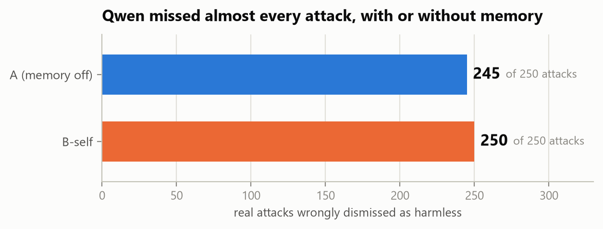
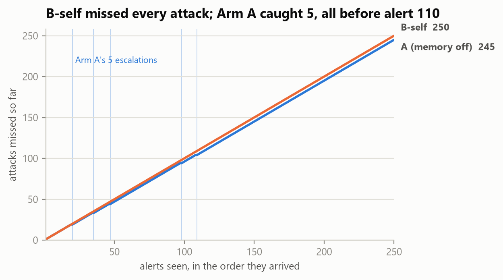
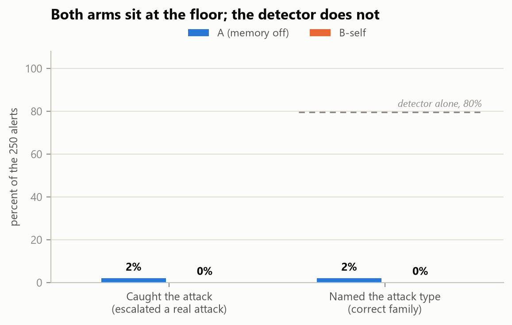
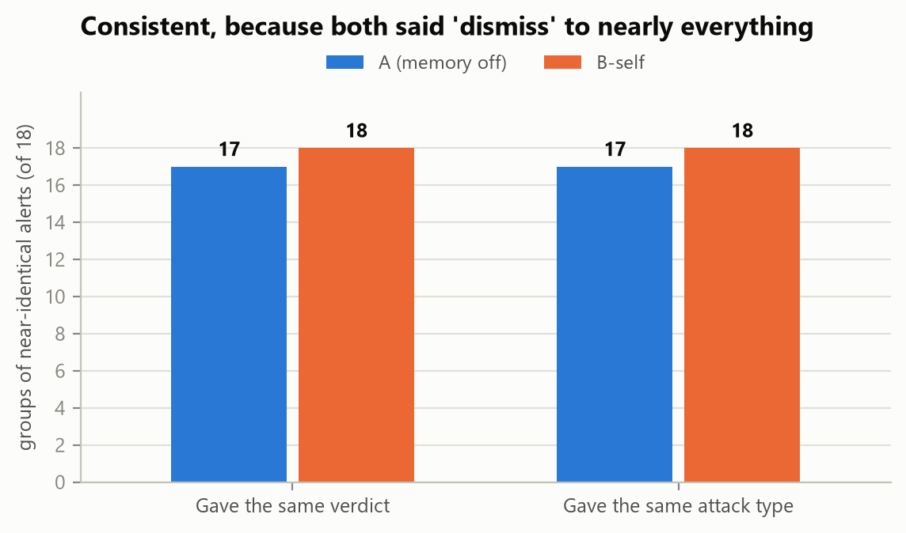

# Qwen 3.8 27B: the first two-arm result on Groq

> **Run:** 250 alerts × 2 arms = 500 verdicts, 2026-10-17 to 2026-10-22, spread over several days by the Groq free-tier token limit (BL-122).
> **Model:** `qwen/qwen3.8-27b` via Groq, temperature 0, output cap 1,000 tokens (BL-121).
> **Prompt variant:** `label-hypothesis-v1`, identical in both arms.
> **Run ids:** `armA-qwen-20261017`, `bself-qwen-20261017`. No B-oracle arm was run.
> **Integrity:** both arms cover the same 250 alerts, in the same stream order. Arm A created no memory store. Every verdict carries the same model id and prompt variant.
> **Scoring:** every number below comes from the unchanged `memsoc.triage.score_verdicts`. The McNemar test is the only addition; the scorer does not have one yet.
> **Figures:** `docs/status-assets/`, regenerated by [`build_qwen_figures.py`](../status-assets/build_qwen_figures.py) in that directory.

---

## 1. The finding in one sentence

**Qwen dismissed almost every real attack as a false alarm, and memory did not change that. Arm A caught 5 of 250 and B-self caught 0. That difference is not statistically significant (p = 0.0625).**

The run is a valid negative result, but it cannot answer the research question. §6 explains why.

---

## 2. What was compared

Each of the 250 alerts was triaged twice: by the same model, with the same prompt template, through the same code. The only thing that changed was memory.

| Arm | What it sees | What goes into memory |
|---|---|---|
| **A (memory off)** | the alert alone | nothing; no store is ever created |
| **B-self** | the alert plus its 3 most similar past alerts, each tagged with **the model's own earlier verdict** | its own verdict, right or wrong |

The terms used below (*verdict*, *recall*, *family*, *McNemar*, *near-duplicate group*) have the same meaning as in the Gemma p3 report on the `aryan` branch (`docs/status/gemma-p3-results.md`, §2).

---

## 3. Result 1: the model missed almost every attack



```
A (memory off)  ██████████████████████  245 missed
B-self          ██████████████████████  250 missed
                └─ of 250 real attacks
```

| Arm | Caught | **Missed** | Caught as a rate |
|---|---:|---:|---:|
| A (memory off) | 5 | **245** | 2.0% |
| B-self | 0 | **250** | 0.0% |

No verdict was "inconclusive", so all 500 answers were decisive calls. Almost all of them were "false alarm".

**Is the difference real?** A paired exact McNemar test looks only at the alerts where the two arms disagreed:

| Comparison | Memory fixed it | Memory broke it | p |
|---|---:|---:|---:|
| B-self vs A, catching attacks | 0 | **5** | 0.0625 |

There are only five disagreements, all in Arm A's favour. That points the same way as "memory made it worse", but five cases are not enough to pass the usual 0.05 bar.



Arm A's five catches came at alerts 20, 35, 47, 98 and 109. All five were Reconnaissance on port 111 (rpcbind). After alert 109, both arms dismissed everything.

---

## 4. Result 2: the attack labels were at the floor too



```
Named the attack family correctly
A (memory off)  █                       2.0%
B-self                                  0.0%
detector alone  ██████████████████      79.6%
```

| Arm | Family named correctly | vs the detector on the same alerts |
|---|---:|---:|
| A (memory off) | 2.0% | −77.6 pts |
| B-self | 0.0% | −79.6 pts |
| *the detector alone* | *79.6%* | — |

This follows from Result 1. When the model calls an alert a false alarm, it gives the family as `none`. So family accuracy can be no better than escalation.

---

## 5. Result 3: "consistent", but only because it said no to everything



| Arm | Same verdict across a group | Same family across a group |
|---|---:|---:|
| A (memory off) | 17 of 18 | 17 of 18 |
| B-self | **18 of 18** | **18 of 18** |

B-self was perfectly consistent, just as it was with Gemma. Here, though, the consistency is empty: it is the same answer, "dismiss", given to every group. The pattern fits the mechanism in the Gemma report, where memory makes the model agree with itself. Its first dismissals are retrieved and repeated, so B-self never escalates even the port-111 probes that Arm A caught. With five discordant alerts, this is suggestive, not shown.

**Latency** was about 1.1 s per alert in Arm A and 1.26 s in B-self. That is Groq inference speed, and it isn't comparable to the Gemma run's 20–40 s.

---

## 6. What this run cannot tell you

1. **There is no benign traffic in the sample.** All 250 alerts are real attacks by `artifacts/ground_truth.csv`, so true negatives and false positives are structurally zero. That is the same limit the Gemma report states for all 1,135 alerts. So nothing can be said about cutting false alarms, the project's stated aim. Arm A's `precision 1.000` is an artefact of this.
2. **The baseline is at the floor.** With a 2% recall baseline there is almost nothing for memory to improve, and too few disagreements for a paired test to detect a harmful effect. Gemma 4 26B on the same prompt had a baseline recall of 74.5% (165 alerts, `aryan` branch). So this result is about **Qwen with this prompt**, not about memory in general.
3. **The model's reasoning overrules the detector.** The rationales argue from flow features that look benign, such as low volume, normal TTLs and a completed handshake, and they discount the detector's score. That is how the model fails on this prompt. Whether to change the prompt is a decision for the team: the prompt is a protected component, and any change must apply to both arms in one commit.
4. **One run per arm, one ordering.** `work-split.md` asks for 3 runs per arm. This is 1.
5. **Run history.** The run was interrupted several times by Groq's daily token limit. On 2026-10-17, two copies of each arm ran concurrently (BL-123):
   - **Arm A:** its file holds 42 duplicate rows. The first row per alert is the one scored. With memory off, each verdict is independent of the others.
   - **B-self:** it was rolled back to its 64 clean alerts and re-run from there. A backup of the state before the rollback is in `artifacts/backups/bself-qwen-20261017-before-rollback-20261018/`. Every B-self verdict scored here saw only memory written before it.

---

## 7. Every number, in one table

| | A (memory off) | B-self |
|---|---:|---:|
| True positives | 5 | 0 |
| False negatives (missed attacks) | 245 | 250 |
| False positives | 0 | 0 |
| True negatives | 0 | 0 |
| Inconclusive | 0 | 0 |
| Precision *(see §6, limit 1)* | 1.000 | 0.000 |
| Recall | 0.020 | 0.000 |
| F1 | 0.039 | 0.000 |
| Family accuracy | 0.020 | 0.000 |
| Detector family accuracy, same alerts | 0.796 | 0.796 |
| Agreement with detector | 0.020 | 0.000 |
| Near-duplicate groups, uniform verdict | 17/18 | 18/18 |
| Near-duplicate groups, uniform family | 17/18 | 18/18 |
| Mean latency | 1.10 s | 1.26 s |
| LLM requests (verdicts scored) | 250 | 250 |
| McNemar on escalation, B-self vs A | 5 vs 0 discordant, p = 0.0625 | |

---

## 8. What this means for the next step

These are tracked as **BL-124**.

- **No claim about memory can be made from this run.** Neither "memory helps" nor "memory hurts" is supported.
- **Before running Qwen again,** the team has to decide two things:
  - whether this model and prompt pairing is usable, given that it dismisses 98% of real attacks with no memory at all;
  - whether to add benign flows to the stream (B2), so the false-alarm question becomes testable.
- **The scorer still needs Person 3's paired McNemar test and confidence intervals** before any result goes into the paper.

---

## Reproducing the figures

```
python docs/status-assets/build_qwen_figures.py
```

Run it in the memory venv, which has `numpy` and `matplotlib`. It reads the two `triage_verdicts.jsonl` files, keeps the first row per alert, takes every metric from the unchanged `memsoc.triage.score_verdicts`, and rewrites the four PNGs beside itself. It needs no embedding model and no network.

---

*Compiled 2026-10-22 from `artifacts/runs/{armA,bself}-qwen-20261017/triage_verdicts.jsonl`.*
