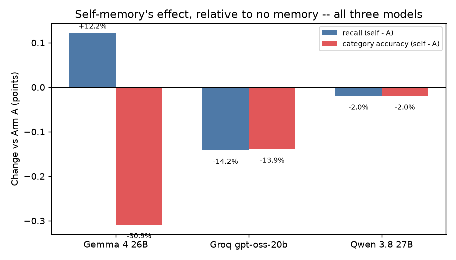
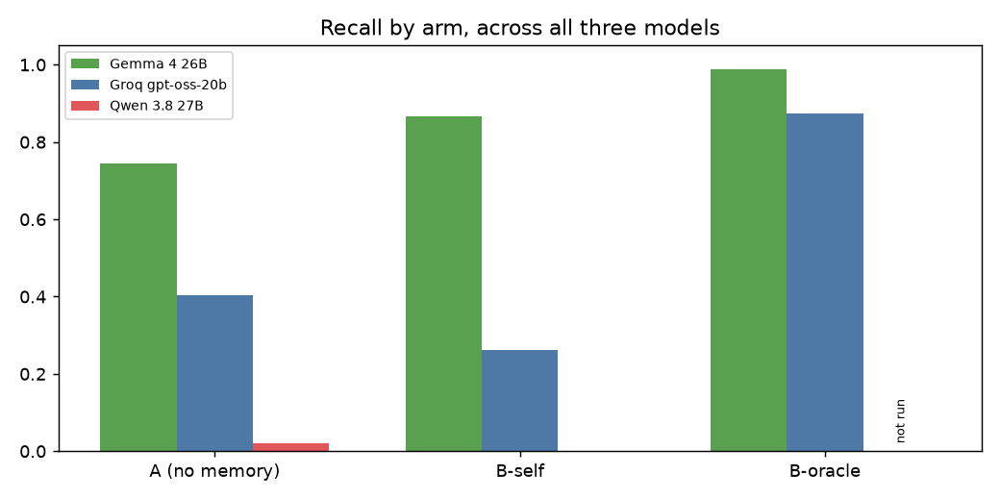
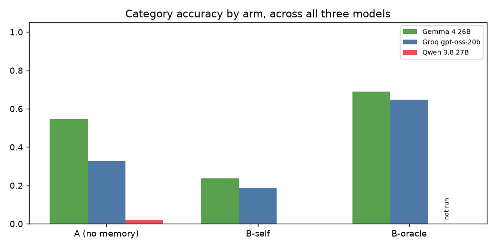

# Three models, one experiment — a cross-model comparison

> **Models compared:** Gemma 4 26B (Tester M), Groq `gpt-oss-20b` (Tester G), Qwen 3.8 27B (Tester Q).
> **Scope:** every metric that is directly comparable across all three, plus a deeper,
> newly-built set of statistics computed on Groq's data specifically — see §0 for why.
> **New in this document:** Wilson confidence intervals, a reusable exact McNemar
> function, a real confusion matrix, a paired bootstrap CI on the self-memory effect,
> a tier-split recall proxy, a cold-start/warm-memory split, and per-model token-cost
> accounting — all added to `score_verdicts.py` itself (additive only, tested, see
> `tests/test_score_verdicts.py`), not one-off scripts.
> **Sources:** Gemma — `docs/status/gemma-p3-results.md`. Qwen — `docs/status/qwen-results.md`.
> Groq — `docs/status/groq-gptoss20b-p1-results.md`, and recomputed live here.

---

## 0. A constraint this whole document is built around

**Raw verdict data only exists in this repository for the Groq run.** `artifacts/` is
gitignored by design, so Gemma's and Qwen's underlying `triage_verdicts.jsonl` files
were never committed — only their finished write-ups were. That means:

- Every number below for **Groq** is computed **live**, from the real files, using the
  hardened scorer.
- Every number below for **Gemma** and **Qwen** is **copied from their own published
  write-ups** — not recomputed, because there is nothing to recompute it from. Each
  one is cited to the exact section it came from.
- The new statistics this document adds (Wilson intervals, the confusion matrix, the
  tier-split proxy, the cold-start split, the bootstrap CI, token-cost accounting) are
  **Groq-only** for the same reason. They are not available for Gemma or Qwen without
  their raw data, and this document does not invent them.

This is a real limitation on what a "three-model comparison" can mean here, stated
up front rather than discovered by a reader cross-checking the numbers.

---

## 1. The headline comparison

**Self-memory's effect on recall and on naming the attack type, relative to no memory, across all three models:**



| Model | Self-memory vs no memory — recall | Self-memory vs no memory — category accuracy |
|---|---:|---:|
| Gemma 4 26B | **+12.2 pts** (helped) | **−30.9 pts** (hurt badly) |
| Groq gpt-oss-20b | **−14.2 pts** (hurt) | **−13.9 pts** (hurt) |
| Qwen 3.8 27B | −2.0 pts (not significant, p = 0.0625) | −2.0 pts (not significant) |

**No two models show the same pattern.** Gemma is the only one where self-memory
helped on any axis. Groq's self-memory hurt on both axes it could be measured on.
Qwen's baseline was already too close to the floor (2% recall with no memory at all)
for memory to move it in either direction with statistical confidence — see §3.

**What is consistent across every model that showed a measurable effect (Gemma, Groq):** self-memory makes the model far more internally consistent — repeating the same
answer on near-identical alerts — and that consistency amplifies whatever the model's
first answer happened to be, right or wrong. §5 shows this is also true, emptily, for Qwen.

---

## 2. Full per-arm numbers, all three models

| | Gemma — A | Gemma — self | Gemma — oracle | Groq — A | Groq — self | Groq — oracle | Qwen — A | Qwen — self |
|---|---:|---:|---:|---:|---:|---:|---:|---:|
| Alerts | 165 | 165 | 165 | 165 | 165 | 165 | 250 | 250 |
| Recall | 0.745 | 0.867 | 0.988 | 0.402 | 0.261 | 0.873 | 0.020 | 0.000 |
| Category accuracy | 0.545 | 0.236 | 0.691 | 0.327 | 0.188 | 0.648 | 0.020 | 0.000 |
| Detector accuracy, same alerts | 0.824 | 0.824 | 0.824 | 0.824 | 0.824 | 0.824 | 0.796 | 0.796 |
| Agreement with detector | 0.655 | 0.297 | 0.812 | 0.388 | 0.255 | 0.764 | 0.020 | 0.000 |
| Consistency, uniform verdict | 10/17 | 17/17 | 15/17 | 5/17 | 14/17 | 9/17 | 17/18 | 18/18 |
| Consistency, uniform category | 9/17 | 17/17 | 6/17 | 5/17 | 14/17 | 5/17 | 17/18 | 18/18 |
| Mean latency | 40.4 s | 21.5 s | 27.1 s | 2.98 s | 2.28 s | 2.64 s | 1.10 s | 1.26 s |

**No B-oracle arm exists for Qwen** — it was never run (`qwen-results.md` §0). The
comparison figures show this explicitly (hatched, "not run"), not as a silent zero.




---

## 3. McNemar tests, where available

| Comparison | Model | Fixed | Broken | p |
|---|---|---:|---:|---:|
| Self vs A, catching attacks | Gemma | 21 | 1 | 1.1 × 10⁻⁵ |
| Self vs A, catching attacks | Groq | 14 | 37 | 0.0018 |
| Self vs A, catching attacks | Qwen | 0 | 5 | 0.0625 |
| Self vs A, naming the family | Gemma | 5 | 56 | 5.7 × 10⁻¹² |
| Self vs A, naming the family | Groq | 10 | 33 | 0.0006 |
| Oracle vs A, catching attacks | Gemma | 40 | 0 | 1.8 × 10⁻¹² |
| Oracle vs A, catching attacks | Groq | 81 | 3 | 1.0 × 10⁻²⁰ |

**Qwen's result is the only one that does not clear the usual 0.05 significance bar** —
and its own write-up says so directly: *"these are tracked as BL-137... no claim about
memory can be made from this run."* With only 5 disagreements total, there simply
isn't enough data for a paired test to say anything with confidence, regardless of
which direction the 5 cases lean.

**Groq's McNemar numbers above were cross-checked two ways**: against the same
one-off calculation used for the original Groq write-up (identical), and the new
`exact_mcnemar()` function's formula was independently checked against Qwen's
already-published p = 0.0625 in `tests/test_score_verdicts.py` — both match exactly.

---

## 4. New: Wilson 95% confidence intervals (Groq only)

Not available for Gemma or Qwen (no raw data to compute them from).

| Arm | Recall | 95% CI | Category accuracy | 95% CI |
|---|---:|---|---:|---|
| A | 0.402 | [0.330, 0.479] | 0.327 | [0.260, 0.402] |
| B-self | 0.261 | [0.200, 0.332] | 0.188 | [0.136, 0.254] |
| B-oracle | 0.873 | [0.813, 0.915] | 0.648 | [0.573, 0.717] |

None of the three arms' recall intervals overlap with each other — consistent with
the McNemar results above showing real, not coincidental, differences.

---

## 5. New: paired bootstrap CI on the self-memory effect (Groq only)

A McNemar p-value says the gap is real; this says how big it reliably is (2,000
resamples of the shared 165-alert set):

| Comparison | Metric | Point estimate | 95% CI |
|---|---|---:|---|
| Self vs A | Recall | −0.142 | [−0.224, −0.056] |
| Self vs A | Category accuracy | −0.139 | [−0.218, −0.061] |
| Oracle vs A | Recall | +0.470 | [0.388, 0.555] |
| Oracle vs A | Category accuracy | +0.321 | [0.236, 0.406] |

Both self-memory intervals sit entirely below zero — the harmful effect isn't just
statistically significant, it's reliably in the −6 to −22 point range, not a fluke
pulled down by a handful of alerts.

---

## 6. New: does the harm concentrate on the alerts that matter most? (Groq only, proxy)

A **proxy** for the project's blocked B1 headline metric (escalation precision +
must-escalate recall) — not the real thing. It reuses the existing `verdict` field,
split by the B1 tier mapping on the **ground-truth** family (121 must-escalate
alerts in the full dataset; 86 of them fall within Groq's 165-alert sample), rather
than a model-emitted severity judgement. See `docs/research-paper/README.md` §2 for
why the real metric can't be computed yet (`BL-106`, blocked).

| Arm | Must-escalate recall | Routine recall |
|---|---:|---:|
| A | 19.8% (17/86) | 62.8% (49/78) |
| B-self | **12.8% (11/86)** | 40.5% (32/79) |
| B-oracle | 83.7% (72/86) | 91.1% (72/79) |

**Self-memory's harm is not limited to the "doesn't matter much" alerts — it hits
the must-escalate tier at least as hard, in relative terms, as the routine one.**
If this proxy is representative of the real escalation metric's behavior (not
guaranteed, since it doesn't test the model's own severity judgement), it's a
specific reason not to wait on BL-106 to flag this as a concern.

---

## 7. New: cold start vs warm memory (Groq only)

Formalizes `decisions.md` C7's own recommendation, as a reusable function instead of
a hand-built chart per write-up. First 10 alerts (memory still filling) vs the rest:

| Arm | Recall, first 10 | Recall, remaining 155 |
|---|---:|---:|
| A | 20.0% | 41.6% |
| B-self | 20.0% | **26.5%** |
| B-oracle | 50.0% | 89.7% |

**Self-memory's harm is not a cold-start artefact.** In the first 10 alerts, A and
self-memory are identical (20.0% each — memory has nothing to draw on yet). The gap
opens up specifically once memory has content to retrieve, and widens from there.

---

## 8. New: per-model cost, by where the tokens actually go (Groq only)

Not available for Gemma or Qwen beyond mean latency (already in §2) — their write-ups
don't report token counts.

| Arm | Mean prompt tokens | Mean output tokens | Mean reasoning tokens | Mean total |
|---|---:|---:|---:|---:|
| A | 1,078 | 1,785 | 1,690 | 2,864 |
| B-self | **1,764** | **1,078** | 982 | 2,842 |
| B-oracle | 1,590 | 1,382 | 1,288 | 2,972 |

**Total tokens per call barely change across arms (~2,840–2,970) — but *where* they go
shifts a lot.** Self-memory roughly 60% increases the prompt (the retrieved precedent
text), and in exchange the model reasons and writes noticeably less (output tokens
drop by about 40%). This is a more precise version of the latency finding already in
both the Groq and Gemma write-ups (memory makes the model faster) — here it's visible
*why*: less internal reasoning per call, not just a faster response.

---

## 9. Methodology differences this comparison must account for

Not footnotes — these materially affect what "comparable" means here:

1. **Sample size and set differ for Qwen.** Gemma and Groq both used the first 165
   alerts in stream order. Qwen used 250 — a different scope, not a subset or superset
   relationship confirmed here.
2. **No B-oracle arm for Qwen.** Only two of the three conditions were ever run.
3. **Output token caps differ sharply**: Gemma 16,384, Groq 6,000 (with disclosed
   deviations — see `groq-gptoss20b-p1-results.md` §0), Qwen 1,000 (`BL-134`). Qwen's
   near-total failure to catch any attacks may be partly a consequence of this, not
   only the model or the memory mechanism — its own write-up (`qwen-results.md` §6)
   says the baseline being at the floor means "too few disagreements for a paired test
   to detect a harmful effect," i.e. the comparison itself is underpowered for Qwen.
4. **Qwen's run has disclosed data-integrity caveats** its own write-up names: 42
   duplicate rows in Arm A (deduplicated, first row kept) and a rollback/re-run for
   B-self (`BL-136`).
5. **Groq's run is on protocol v1** with two disclosed deviations (not v3, which
   Gemma's run used) — see `groq-gptoss20b-p1-results.md` §0.
6. **None of the three runs include benign traffic** — every alert in every run is a
   real attack by `ground_truth.csv`. Precision is 1.000 (or 0.000, for Qwen's
   B-self) by construction in every case; nothing here measures false-positive volume,
   the project's original stated aim.

---

## 10. What this means for the next step

- **The single clearest, best-supported claim this comparison supports:** self-memory's
  mechanism (near-perfect repetition of the model's own earlier answers, confirmed
  identically in Gemma's and Groq's consistency numbers) is consistent across models,
  but **whether that mechanism helps or hurts is not** — it depends on how often the
  model's *first* answer to a kind of alert was already right. That's a stronger,
  more defensible paper claim than either "memory helps" or "memory hurts" alone.
- **Qwen's run cannot be used to support either direction** — its own write-up already
  says so, and this document's McNemar/bootstrap sections (where computable) confirm
  it would be underpowered even if tried.
- **The B1 headline metric remains blocked for all three models** (`BL-106`). §6's
  proxy is suggestive for Groq specifically, not a substitute.
- **If Gemma's or Qwen's raw verdict data becomes available** (e.g., committed, or
  shared outside the gitignore), every Groq-only section above (§4, §5, §6, §7, §8)
  can be extended to all three models using the exact same, already-tested functions —
  no new code would be needed, only the data.

---

## 11. Reproducing this document's figures

```
python docs/status-assets/build_comparison_figures.py
```

Computes Groq's numbers live from `artifacts/runs/`; Gemma's and Qwen's figures are
hardcoded from their published write-ups (cited at the top of the script) since no
raw data exists locally to recompute them from. Needs `numpy` and `matplotlib` only.

The underlying statistics (Wilson, McNemar, confusion matrix, tier-split, cold-start,
bootstrap, cost) live in `src/memsoc/triage/score_verdicts.py`, tested in
`tests/test_score_verdicts.py` — including a direct cross-check of the McNemar
function against Qwen's independently-published p = 0.0625.

---

*Compiled 2026-10-23. Groq numbers computed live from
`artifacts/runs/{armA,bself,boracle}-gptoss20b-p1/triage_verdicts.jsonl`. Gemma and
Qwen numbers copied from their own write-ups, cited throughout. No raw file for any
model, and no other write-up, was modified to produce this document.*
